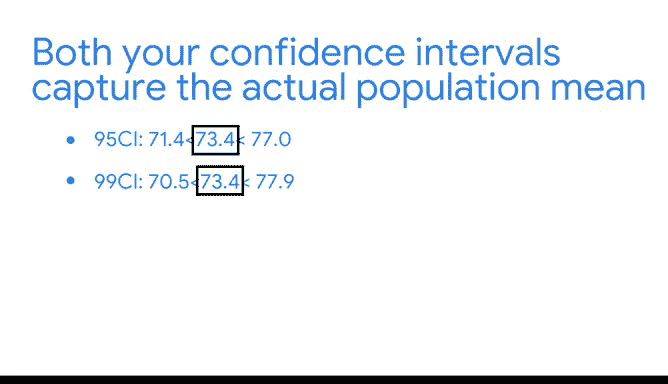

# 谷歌高阶数据分析4：《统计的力量》the-power-of-statistics（中英双字） - P43：43_04_01_使用Python计算置信区间.zh_en - GPT中英字幕课程资源 - BV1yk4y1G7Qm

Earlier， we talked about how data professionals use sample data to make point estimates about population parameters。

 For example， a data professional might take a random sample of 100 home prices in Mexico City to estimate the average price of all homes in Mexico City。

 A point estimate can provide a general idea of a population parameter。

 but estimates usually include some error due to sampling variability。 and in practice。

 taking repeated samples to get improved estimates is often too expensive in time consuming。

So data professionals use confidence intervals to describe the uncertainty of an estimate and give stakeholders more information to work with。

In this video， you'll use Python to construct a confidence interval for a point estimate。

We'll continue with our previous scenario in which you are data professional working for the Department of Education of a large nation。

Recall that you're analyzing data on the literacy rate for each district。

 you'll continue to use the data that you worked with before if you need to access the data。

 do so now。In a previous video， we imagined that the Department of Education asked you to collect the data on district literacy rates。

 You were only able to survey 50 randomly chosen districts instead of all 634 districts included in your original data set。

 you use Python to simulate taking a random sample of 50 districts and making a point estimate of the population mean or literacy rate for all districts。

😊，Now， as a next step， imagine that the department asks you to construct a 95% confidence interval for your estimate of the mean district literacy rate。

You can use Python to construct the confidence interval。Let's open up a Jupiter notebook and begin。

First， import the Python packages you plan to use， nuumpy and pandas。To save time。

 rename your packages with abbreviations， NP and PDD to load the Sippi stats module right from Sippi importm stats。

You can also use the same sample data that you worked with in a previous video。

 write the code to have Python simulate the same random sample of district literacy rate data。First。

 name your variable， sampled， underscore data， then enter the arguments of the sample function。

 and sample size equals 50。 replace equals true because you are sampling with replacement。

For random underscore state， choose the same random number to generate the same results。Previous。

 you used 31208。Now， display the value of your variable。

 The output shows 50 districts selected randomly from your data set。

Each has a different literacy rate。In previous videos。

 you constructed a confidence interval step by step， let's review the four main steps。One。

 identify a sample statistic。Two， choose a confidence level，3， find the margin of error，4。

 calculate the interval。Earlier， you worked through these steps one by one to construct a confidence interval。

With Python， you can construct a confidence interval with just a single line of code and get your results faster。

If you're working with a large sample size， say larger than 30。

 you can construct a confidence interval for the mean using s by stats dot norm dot interval function。

This function includes the following arguments。 Alpha refers to the confidence level。

 Loke refers to the sample mean， and scale refers to this sample standard error。

Let's explore each argument in more detail。First， alpha or your confidence level。

The Education Department requests a confidence level of 95%。

 which is the accepted standard for government funded research。Second， Lo or the sample mean。

 This is the mean literacy rate of your sample of 50 districts。 name a new variable sample。

 underscore mean。Then compute the mean district literacy rate for your sample data。

 third scale or the sample standard error。Recall that standard error measures the variability of your sample data。

 You may remember that the formula for the sample standard error is the sample standard deviation divided by the square root of the sample size。

You can write code to express the formula and have Python do the calculation for you。 First。

 name a new variable estimated underscore standard underscore error。Next。

 take the standard deviation of your sample data and divide by the square root of your sample。

Then in parentheses， write the name of your data frame followed by the shape function and0 in brackets。

Recall that the shape function returns the number of rows and columns in a data frame。

Shape  zero returns only the number of rows， which is the same number as your sample size。

Now you're ready to put all this together to construct your confidence interval with the stats dot norm dot interval function。

First， write out the function and set the arguments for alpha set 0。

95 because you want to use a 95% confidence level for Lo， enter the variable sample， underscore mean。

 and for scale， enter the variable estimates， underscore standard， underscore error。

Then run the code and out comes your confidence interval。 Python makes this process super efficient。

 You have a 95% confidence interval for the mean district litacy rate that stretches from about 71。

4% to 77。0%。The Department of Education will use your estimate of the mean district literacy rate to help make decisions about distributing funds to different states。

Now， imagine that a senior director in the department wants to be even more confident about your results。

 The director wants to make sure you have a reliable estimate and suggests that you recalculate your interval with a 99% confidence level to choose a new confidence level。

 copy and paste your previous code。Change your alpha from 0。95 to 0。

99 to compute a 99% confidence interval based on the sample data。

Now run the code and here's your confidence interval。

 You have a 99% confidence interval for the mean district literacy rate that stretches from about 70。

5% to 77。9%。You may notice that as the confidence level gets higher。

 the confidence interval gets wider。With a confidence level of a 95%， the interval covers 5。

6 percentage points。With a confidence level of 99%， the interval covers 7 percentage points。

 This is because a wider confidence interval is more likely to include the actual population parameter。

In our scenario for this video， you only have data on 50 districts。 However， in earlier videos。

 you computed the mean literacy rate for all 634 districts in your data set as about 73。4%。

 So as it turns out， both your confidence intervals capture the actual population mean your results will help the Department of Education decide how to distribute government resources to improve literacy。

