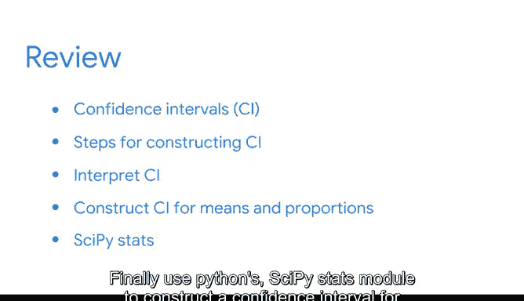

# 谷歌高阶数据分析4：《统计的力量》the-power-of-statistics（中英双字） - P44：44_04_01_总结_4.zh_en - GPT中英字幕课程资源 - BV1yk4y1G7Qm

This is the end of your introduction to confidence intervals。

 You've come a long way since the beginning of the course。 Congrats on all your progress。

 We've talked it often about how data professionals use sample statistics to make estimates about population parameters。

 In this part of the course， we estimated the mean emission rate of a car engine and the mean battery life of a cell phone。

😊，Confidence intervals help express the uncertainty in an estimate and share a range of possible outcomes。

For instance， I can say the marketing campaign will generate $200000 in new sales。

 or I can say based on a 95% confidence level， I estimate the marketing campaign will generate between 150000 and $250000 in new sales revenue。

 Both predictions might be reasonable， but the confidence interval expresses the uncertainty in the estimate and gives a stakeholder more information to work with and having more information helps them make better decisions。

Sharing reliable estimates with stakeholders has a positive impact on an organization。For example。

 imagine you're a data professional working with a shipping company that transports products around the world。

You can use confidence intervals to help estimate economic factors such as fuel prices。

 shipping costs， local tariffs， and more。This information helps company leaders minimize risk。

 avoid unnecessary expenses， and increase efficiency。

And improving the speed and security of shipping will benefit the thousands of people who rely on your company's services。

 In this part of the course， we discussed the role of confidence intervals in data analytics。

 and we reviewed the basic steps for constructing a confidence interval。 Next。

 you learned how to interpret a confidence interval。

 and how to avoid common misinterpretations of their results。

We listed the steps for constructing a confidence interval from identifying a sample statistic and choosing a confidence level to finding the margin of error and specifying the interval。

Then you learned how to construct confidence intervals for both means and proportions。 finally。

 use Python's sipi stats module to construct a confidence interval for a point estimate of a population mean。

Soon， you'll take a graded assessment to prepare， check out the reading that lists all the new terms you've learned and feel free to revisit videos。

 readings and other resources that cover key concepts。 You're doing a great job。 Keep it up。😊。

