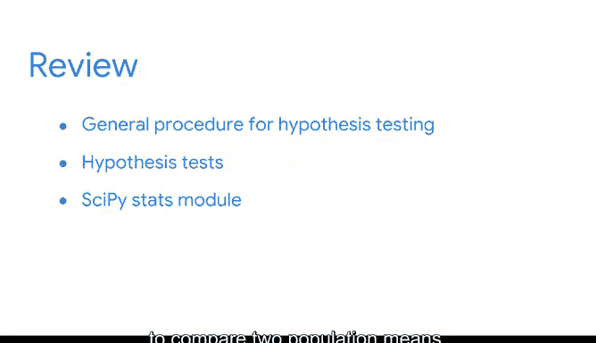

# 谷歌高阶数据分析4：《统计的力量》the-power-of-statistics（中英双字） - P45：45_05_01_欢迎来到模块五.zh_en - GPT中英字幕课程资源 - BV1yk4y1G7Qm

Hey there， future data professional， you've come a long way since the beginning of your learning journey。

 Way to go。Just think of all the new skills you've developed。

 You can calculate descriptive stats like the mean and standard deviation to summarize your data。

 You can use probability distributions like the binomial。

 Poisson and normal distribution to model different types of data。

 You can work with sampling distributions to estimate population means and proportions。

And you can construct confidence intervals to help describe the uncertainty of an estimate。

Now you're going to add a new skill to your skill set。

 Hy testing Hy testing is a statistical procedure that uses sample data to evaluate an assumption about a population parameter。

For example， hypothesis tests are often used in clinical trials to determine whether a new medicine leads to better outcomes in patients。

Imagine a pharmaceutical company invents a medicine to treat the common cold。

 The company tests a random sample of 200 people with cold symptoms。Without medicine。

 the typical person experiences cold symptoms for 7。5 days。

The average recovery time for people who take the medicine is 6。2 days。The company might then ask。

 are the results of the clinical trials statistically significant。

 recall that statistical significance is the claim that the results of a test or experiment are not explainable by chance alone。

In other words， did the drug actually have a positive impact on recovery time？

Or are the results due to chance or sampling variability。To answer these questions。

 the company may ask a data professional to conduct a hypothesis test。

The test helps quantify whether the result is likely due to chance or if it's statistically significant。

This knowledge will help the company determine if the drug is truly effective and if it should be approved for public use。

Coming up， we'll go over the general procedure for hypothesis testing from stating the null hypothesis and alternative hypothesis to choosing a significance level。

 finding the P value and rejecting or failing to reject your null hypothesis。

Then we'll explore two different types of eye hypothesis tests， one sample and two sample。 Finally。

 you'll learn how to use Python sip Pi stats module to conduct a two sample hypothesis test to compare two population means。

 When you're ready to learn more， I'll meet you in the next video。

