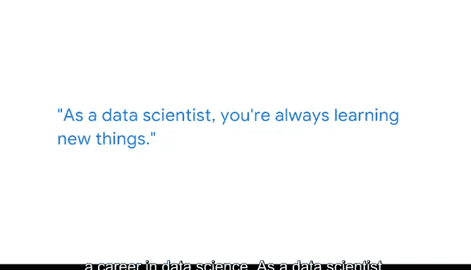

# 谷歌高阶数据分析4：《统计的力量》the-power-of-statistics（中英双字） - P46：46_05_02_Elea：在不断变化的数据空间中持续学习.zh_en - GPT中英字幕课程资源 - BV1yk4y1G7Qm

Hi， my name is Elilia and I'm a data science intern at Google。

 so I am originally from France and I grew up there and did most of my study there and I have always been very interested in math and during the beginning of my college education。

 I also discovered computer science and starting building skills in computer science and for my first internship in France I was looking for ways to apply these two fields to a real life question and I came upon data science internships and this made me want to continue my career in data science and specialize in data science and I've always been looking at the different applications of data science in AI in healthcare and this is why I was very interested in working at Google and specifically at Ver what excites me the most is being able to work。

on data sets related to healthcare and generate insights and build models that can actually have an impact on either patients or the healthcare industry as a whole a data science intern at Google is given a project to work on during the duration of the internship and I specifically worked on clinical natural language processing which is basically the ability to extract relevant information from clinical notes using me learning methods and to generate insight from them so I definitely think my internship has prepared me so much for a care in data science as a data scientist you're always learning new things there's always new state of the arts models coming out and it's always really interesting to keep up to date with them and to really learn how they work so that you're able to tailor them to your years case one of the parts of the project was to extract social determinants of。

Health from patient record records and notes。 and then I explored them。

I explored the relationships between these social determinants of health and some really interesting associations came up。

 some things that were already known but I feel that it was really cool to be able to observe them myself and my work so I think what's so great about data science and being a data science is that data science can have an impact on any field so if you're interested in something that has nothing to do with data science。

 Im pretty sure that you can find a job that relates to it。

 look at the industries that you're interested in and most likely there's gonna to be a data science job there。

😊。