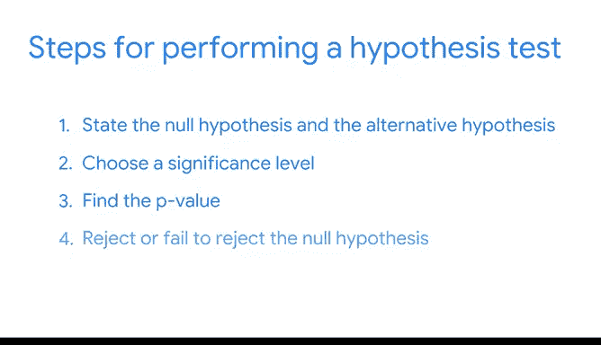
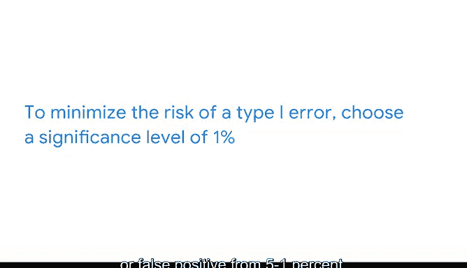

# 谷歌高阶数据分析4：《统计的力量》the-power-of-statistics（中英双字） - P47：47_05_03_假设检验介绍.zh_en - GPT中英字幕课程资源 - BV1yk4y1G7Qm

Recently， you learned that a hypothesis test uses sample data to evaluate an assumption about a population parameter。

 For example， for a clinical trial of a new medicine。

 a hypothesis test can help you determine if the effect of the medicine on the average recovery time of your sample group is statistically significant or due to chance。

In this video， we'll go over the procedure for performing a hypothesis test and you'll learn about the main concepts involved in hypothesis testing。

Let's outline the steps for performing a hypothesis test。 First。

 state the null hypothesis and the alternative hypothesis。 Second， choose a significance level。

 Third， find the P value and fourth， reject or fail to reject the null hypothesis。

Right now， these concepts may seem a bit abstract。 That's okay。

 You'll learn more about each one by the end of this video For now。

 to clarify the steps involved in hypothesis testing， let's explore an example。 Afterwards。

 we'll revisit the concepts。Imagine you are given a coin to use in a game。

 You're not sure if the coin is fair or rigged。 That is。

 you don't know if it's a standard coin or if it's been specifically weighted to affect the outcome of a toss。

 For example， to always land on tails。 before using it in the game。

 you want to find out if the coin is fair or not。 You decide to test the coin by tossing it six times in a row and recording the outcomes。

As you may recall from our earlier discussion of probability， if the coin is fair。

 the chance of landing on heads or tails is 0。5 or 50 per cent for any given toss。

 If the coin is rigged for tails， the chance of landing on tails for any given toss will be much higher。

 perhaps 90 or even 100 per cent。Before you test it out。

 you need to have a benchmark to evaluate the results of the test。For example。

 let's say the first two tosses land on tails。 Is the coin rigged。

Recall that we will use the multiplication rule to calculate the probability of independent events。

So the probability of the coin landing on tails two times in a row is 0。5 times 0。5， which is 0。

25 or 25 per。 That's not unlikely。 At this point， you can't reasonably conclude that the coin is rigged。

 Now， imagine the coin lands on tails four times in a row。The probability of this occurring is 0。

5 multiplied four times， which is 0。0625 or 6。25%。 That's unlikely， but not impossible。 However。

 you want to feel even more confident that the outcome is not due to chance。

You decide to use 5% as a threshold to determine if the outcome is due to chance。In other words。

 if the probability of the outcome is less than 5% under the assumption that the coin is fair。

 you'll conclude that the coin is actually rigged。For example。

 the probability for a fair coin to land on tails  six times in a row is 0。5 multiplied  six times。

 which is 0。0156 or 1。56 per。 This is too unlikely because the likelihood is less than your threshold of 5 per cent。

 If this occurs， you'll conclude the coin is rigged。Now， you're ready to proceed with your test。

 You toss the coin six times in a row and record the results。 The coin lands on tails every time。

 you conclude that the coin is rigged。 Unfortunately。

 the coin won't be of much use to you unless you're performing the magic trick and happen to need a coin that always lands on tails。

This example is a simplified version of a hypothesis test to test out whether or not the coin is fair。

 you went through each step of the hypothesis testing procedure。

Let's review the steps for conducting a hypothesis test。 First。

 state the null hypothesis and the alternative hypothesis。 Second， choose a significance level。

 Third， find the P value4， reject or fail to reject the null hypothesis。Now。

 let's explore each step in more detail。First， state your null hypothesis and your alternative hypothesis。

 The null hypothesis is a statement that is assumed to be true unless there is convincing evidence to the contrary。

 The null hypothesis typically assumes that your observed data occurs by chance。

 The alternative hypothesis is a statement that contradicts the null hypothesis and is accepted as true only if there is convincing evidence for it。

The alternative hypothesis typically assumes that your observed data does not occur by chance。

 In our example， your null hypothesis states that the coin is fair。

 Having a fair coin is the standard or typical state of things。

The null hypothesis states that your observations result purely from chance。

Your alternative hypothesis states the contrary claim， the coin is not fair。

The alternative hypothesis says that the outcome was the result of rigging and did not happen by chance。

Next， choose your significance level。 This is the threshold at which you will consider results statistically significant。

 The significance level is also the probability of rejecting the null hypothesis when it is true。

 I'll talk more about this later in the video。 In our example。

 you use 5 per as a threshold to determine if the outcome of the coinintass occurred by chance。

 Typically， data professionals set the significance level at 5 per cent。

Note that there is nothing magical about 5%。 This is a choice based on tradition in statistical research and education。

You can adjust the significance level to meet the requirements of your analysis。

 Other common choices are 1% and 10%。Next， find your P value。

P value refers to the probability of observing results as or more extreme than those observed when the null hypothesis is true。

We already calculated that the probability of fair coin landing on tails six times in a row is 1。56%。

So if you assume the null hypothesis is true and the coin is fair。

 then the P value in our example is 1。56%。Anything lower than that would mean that there is stronger evidence for the alternative hypothesis。

Remember， your alternative hypothesis is that the coin is not fair。 For instance。

 the probability of tossing 7 tails in a row with a fair coin is 0。79%。

 which is lower than the P value of 1。56%。If you to seven tails in a row。

 you'd have even stronger evidence for the alternative hypothesis that the coin is not fair。Finally。

 you have to decide whether to reject or fail to reject the null hypothesis。

 Statisticians always say fail to reject rather than accept。

This is because hypothesis tests are based on probability， not certainty。

 and acceptance implies certainty。In general， as data professionals。

 we try not to claim certainty about results based on statistical methods。

There are two main rules for drawing a conclusion about a hypothesis test。

 If your P value is less than your significance level， you reject the null hypothesis。

 If your P value is greater than your significance level， you fail to reject the null hypothesis。

In the example of the coininta， your P value of 1。56% is less than your significance level of 5%。

 So you reject the null hypothesis and conclude that your result of 6 consecutive tails is statistically significant and not due to chance。

 Your decision to reject or fail to reject also depends on your significance level。

 Let's say before your test， you chose a significance level of 1 per cent instead of 5 per。

In that case， you would fail to reject the null hypothesis because your P value of 1。

56% would be greater than your significance level of 1%。

A statistically significant result cannot prove with 100% certainty that a hypothesis is correct。

Because hypothesis testing is based on probability。

 there's always a chance of drawing the wrong conclusion about the null hypothesis in hypothesis testing。

 there are two types of errors you can make when drawing a conclusion。

 a type 1 error and a type 2 error， a type 1 error also known as a false positive occurs when you reject null hypothesis that is actually true。

 In other words， you conclude that your result is statistically significant when in fact。

 it occurred by chance。In our example， concluding that the coin is rigged when it's actually fair would be considered to type one error。

Even though you got six tails in a row， this outcome could still be due to chance。

 it's highly unlikely， but it's possible。Earlier in the video。

 I mentioned that your significance level is also the probability of rejecting the null hypothesis when it is true。

 A significance level of 5 per cent means you are willing to accept a 5 per cent chance you are wrong when you reject the null hypothesis。

To reduce your chance of making a type1 error， choose a lower significance level。

 recall that if you choose a 1% significance level。

 you fail to reject the null and conclude that third coin is fair。However。

 choosing a lower significance level means you're more likely to make a type 2 error or false negative。

This occurs when you fail to reject a null hypothesis， which is actually false。In other words。

 you conclude your result occurred by chance when it's in fact， statistically significant。

In our example， you would conclude that the coin is fair when it's actually rigged。

As a data professional， it helps to be aware of the potential errors built into hypothesis testing and how they can affect your results。

Depending on the situation and the goal of your analysis。

 you may want to minimize the risk of either a type 1 or type 2 error。

Imagine you're testing the strength of a fabric for a parachute manufacturer。

You want to be very confident that the material you're using is strong enough for a functional parachute。

 a type 1 error or false positive means you falsely identify the material as strong enough。Obviously。

 in this case， you want to minimize the risk of a type 1 error to do so。

 choose a significance level of 1% instead of the standard of 5%。

This change decreases the chance of a type 1 error or false positive from 5% to 1%。

Ultimately， it's your responsibility as a data professional to determine how much evidence you need to decide that a result is statistically significant。

 how risky is a type1 error or a false positive。There's no single correct answer for all these situations。

 It's up to you to decide。 That's all for now。 The coininass example shows you the main concepts involved in conducting a hypothesis test。

As a data professional， you'll use these concepts for any hypothesis test that you may want to conduct。

