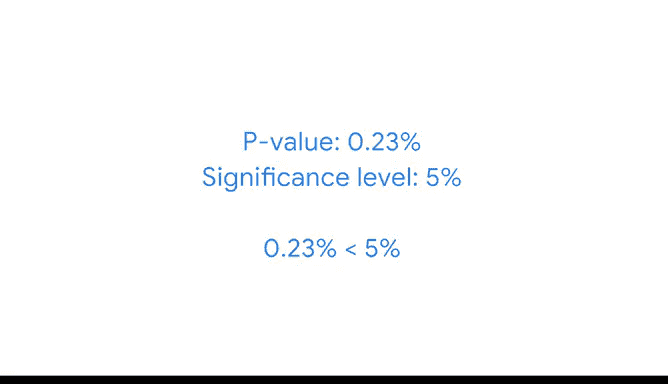

# 谷歌高阶数据分析4：《统计的力量》the-power-of-statistics（中英双字） - P48：48_05_01_单样本均值检验.zh_en - GPT中英字幕课程资源 - BV1yk4y1G7Qm

Earlier， I mentioned that there are two different types of hypothesis tests。

 one sample and two sample。 A one sample test determines whether or not a population parameter like a mean or proportion is equal to a specific value。

A two sample test determines whether or not two population parameters。

 such as two means or two proportions are equal to each other。 We'll explore two sample tests。

 later on。A data professional might conduct a one sample hypothesis test to determine if a company's average sales revenue is equal to a target value。

 A medical treatment's average rate of success is equal to a set goal。

 or stock portfolios average rate of return is equal to a market benchmark。In this video。

 you'll conduct a one sample hypothesis test。 We'll explore an example involving data for an online delivery company。

 There are different types of hypothesis tests you can use based on the type of sample data you're working with。

In this course， we focus on Z tests and T tests， two of the most commonly used tests in data analytics。

If these terms seem familiar， it's because they're related to Z scores and T scores。

 which we've worked with before。The one sample Z test makes the following assumptions。

 The data is a random sample of a normally distributed population。

 The population standard deviation is no。Imagine you're a data professional who works for an online delivery company。

 Typically， the mean delivery time for an online food order is 40 minutes with a standard deviation of five minutes。

But recently， company management launched a new training program to make the delivery process more efficient。

After delivery drivers completed the training program。

 management tracked a random sample of 50 deliveries to understand how long a delivery takes。

The sample of 50 deliveries had a mean delivery time of 38 minutes with a standard deviation of five minutes。

There is an observed difference of two minutes between the population mean of 40 minutes and the sample mean of 38 minutes。

The management team asks you to determine if the decrease in average delivery time is statistically significant。

 or if it's due to chance。If the decrease is statistically significant。

 the company wants to invest in developing and implementing the training program in other regions。

You decide to conduct a one sample Z test to analyze the data。

Let's review the steps for conducting hypothesis test。First。

 state the null hypothesis and the alternative hypothesis。Second， choose a significance level。Third。

 find the P value， fourth， reject or fail to reject the null hypothesis。

Start by stating your null hypothesis and alternative hypothesis recall that the null hypothesis is a statement that is assumed to be true unless there is convincing evidence to the contrary。

In a one sample Z test， the null hypothesis states that the population mean is equal to an observed value。

In this case， your null hypothesis says that the average delivery time equals 40 minutes。

40 minutes is this standard average delivery time。The alternative hypothesis is a statement that contradicts the null hypothesis。

In a one sample test， there are three main options for the alternative hypothesis。

 The population mean is not equal to。Less than or greater than an observed value。 In this case。

 you want to test whether the training has decreased the average delivery time。

 Your alternative hypothesis says the average delivery time is less than 40 minutes。Next。

 set this significance level or the threshold at which you will consider a result statistically significant。

 This is also the probability of rejecting the null hypothesis when it is true。

 You choose a significant level of 5%， which is the company's standard for data analysis。Now。

 find the P value。 recall that your P value is the probability of observing a difference in your results。

 as or more extreme than the difference observed when the null hypothesis is true。Typically。

 the mean delivery time is 40 minutes。The mean delivery time of your sample is 38 minutes。

Your null hypothesis claims that this two minute difference in delivery time is due to chance or sampling variability。

Your P value is the probability of observing a difference that is two minutes or greater if the null hypothesis is true。

If the probability of this outcome is very unlikely， in particular。

 if your P value is less than your significance level of 5%。

 then you will reject the null hypothesis。As a data professional。

 you'll almost always calculate P value on your computer。

 using a programming language like Python or other statistical software。However。

 let's briefly explore the concepts involved in the calculation to get a better understanding of how it works。

Being able to use code for calculations is important for your future career。

 but being familiar with the concepts behind the calculations will help you apply statistical methods to workplace problems The P value is calculated from what's called a test statistic。

In hypothesis testing， the test statistic is a value that shows how closely your observed data matches the distribution expected under the null hypothesis。

So if you assume the null hypothesis is true and the mean delivery time is 40 minutes。

 the data for delivery times follows a normal distribution。

 The test stat shows where your observed data， a sample mean delivery time of 38 minutes will fall on that distribution。

Since you are conducting a Z test， your test statistic is a z score。

 recall that a Z score is a measure of how many standard deviations below or above the population mean a data point is Z scores tell you where your values lie on a normal distribution。

The following formula gives you a test statistic Z based on your sample data。

Z equals x bar minus mu divided by the quotient of sigma divided by the square root of n。

Where X bar is the sample mean， mu is the population mean。

 Sigma is the populations standard deviation， and n is the sample size。

If you enter the numbers in the formula and do the calculation， you get a z score of negative 2。82。

Let's check out where the z score negative 2。82 lies on in the distribution。 It's far to the left。

 almost three standard deviations below the mean for a normal distribution。

 the probability of getting a value less than your z score of negative 2。

82 is calculated by taking the area under the curve to the left of the z score。

This is called a left tail test because your P value is located on the left tail of the distribution。

The area under this part of the curve is the same as your P value。Again。

 your P value is the probability of observing a test statistic as or more extreme than that observed when the null hypothesis is true。

Your alternative hypothesis states that the mean delivery time decreased based on your sample data。

 That's why we're interested in the probability of getting any value as low or lower than your Z score of negative 2。

82 In a different testing scenario。 your test statistic might be positive 2。45。

And you might be interested in values as high or higher than the z score 2。45。 In that case。

 your P value would be located on the right tail of the distribution。

 and youd be conducting a right tail test。If you calculate the P value， you'll find that it's 0。0023。

 So your P value is 0。0023 or 0。23%。 This means there is a 0。

23% probability that the difference in mean delivery time would be two minutes or greater if the null hypothesis is true。

 In other words， it's highly unlikely that the difference is due to chance。

To draw a conclusion about your null hypothesis， compare your P value with the significance level。

 If your P value is less than the significance level。

 you conclude that there is a statistically significant difference in mean delivery time。

 In other words， you reject the null hypothesis。 If your P value is greater than the significant level。

 you conclude that there is not a statistically significant difference in mean delivery time。

In other words， you fail to reject the null hypothesis。Yoururop P value of 0。0023 or 0。

23% is less than the significance level of 0。05 or 5%。

So you reject the null hypothesis and conclude that there is a statistically significant difference in mean delivery time。

Your results suggest that the faster delivery time is likely due to the positive effects of the training。

Your analysis will help company leadership decide whether to make a bigger investment in the training program going forward based on your results。

 theyre likely to do so。