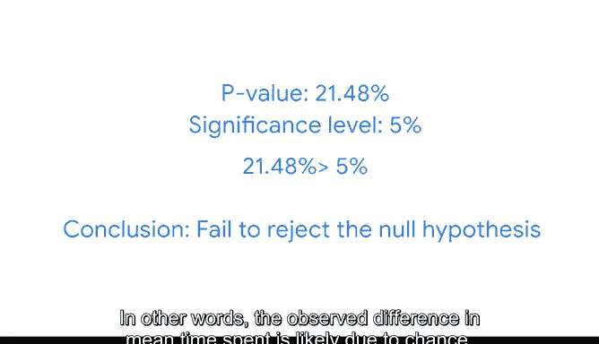

# 谷歌高阶数据分析4：《统计的力量》the-power-of-statistics（中英双字） - P49：49_05_01_双样本均值检验.zh_en - GPT中英字幕课程资源 - BV1yk4y1G7Qm

Earlier， you conducted a one sample hypothesis test to analyze data on the mean delivery time for an online food delivery service。

 Com up， we'll explore a two sample test for means。

 While a one sample test determines whether a population mean is equal to a specific value。

 a two sample test determines whether two population means are equal to each other。In data analytics。

 two sample tests are frequently used for A B testing。 In my career as a data professional。

 I've conducted a number of A B tests to help companies improve their online business。 Typically。

 I use a two sample T test to analyze the data。 For example。

 let's say an online retail store is considering changing the landing page for its reward club members who are the most loyal customers。

 The metric that matters most to the company is the average time users spend on the landing page per session。

😊，First， I'd set up an experiment for two groups of users。 Group A uses the default landing page。

 and group B uses a redesigned version of the landing page。

 Then I'd use a T test to compare the average time spent on each landing page and determine if the difference between the two sample means is statistically significant。

 In other words， if group B spends more time on the landing page than group A。

 the T test will help determine if that's due to chance or to the new design of the landing page。

In this video， you'll conduct a two sample T test to compare two population means。

 We'll work through an example based on the scenario I just shared with you in data analytics。

 the two sample T test is the standard approach for comparing two means。

 The two sample T test for means makes the following assumptions。

The two samples are independent of each other。For each sample。

 the data is drawn randomly from a normally distributed population。

The population standard deviation is unknown。 Typically。

 data professionals use a Z test when the population standard deviation is known and use a T test when the population standard deviation is unknown and needs to be estimated from the data。

In practice， the population standard deviation is usually unknown because it's difficult to get complete data on large populations。

 So data professionals use the T test for practical applications。

 While the test statistic for a Z test is a Z score， the test statistic for a T test is a T score。

 And while Z scores are based on the standard normal distribution。

 T scores are based on the T distribution。 The graph of the T distribution has a bell shape that is similar to the standard normal distribution。

 But the T distribution has bigger tails than the standard normal distribution does。

 The bigger tails indicate the higher frequency of outliers that come with small data set。

As the sample size increases， the T distribution approaches the normal distribution。For a T test。

 the test statistic follows a T distribution under the null hypothesis。

Let's explore how to conduct a two sample tea test。

 Imagine you're a data professional who works for a cosmetics company。

 The company is researching the amount of time customers spent on its website。

 Your team leader asks you to conduct an A B test to determine if changing the background color of the landing page from gray to green has any effect on the average time spent on the page。

 You randomly select two groups of users。 The first group visits the gray landing page named version A。

 The second group visits the green landing page named version B。😊。

You collect the following data from the A B test。40 users visit version A。

 They spend a mean time of 300 seconds with a standard deviation of 18。5 seconds。

38 users visit version B。They spend a mean time of 305 seconds， with a standard deviation of 16。

7 seconds。 There is an observed difference of 5 seconds。

 or 305-300 between the mean time spent on version B and version A。

 You decide to conduct a two sample T test to analyze the data。

Let's review the steps for conducting a hypothesis test。 First。

 state the null hypothesis and the alternative hypothesis。 Second， choose its significance level。

 Third， find the P value， fourth， reject or fail to reject the null hypothesis。First。

 state your nu hypothesis and alternative hypothesis。In a two sample T test。

 the null hypothesis states there is no difference between the two population means。

This is assumed to be true unless there is convincing evidence to the contrary。

 So for your all hypothesis， you say there is no difference in the mean time spent on version A and version B。

Your alternative hypothesis will state the contrary claim。

 There is a difference in the mean spent on version A and version B。Next。

 set the significant level or the threshold at which you will consider a result statistically significant。

This is the probability of rejecting the null hypothesis when it is true。

 you choose a significant level of 5 per， which is the company's standard for A B testing。 Now。

 find the P value。In this case， your P value is the probability of observing a difference in your sample means as or more extreme than the difference observed when the null hypothesis is true。

Based on your sample data， the difference between the mean time spent on version A and version B is 5 seconds。

 Your null hypothesis claims that this difference is due to chance。

Your P value is the probability of observing an absolute difference in sample means that is5 seconds or greater if the null hypothesis is true。

If the probability of this outcome is very unlikely， in particular。

 if your P value is less than your significance level of 5%。

 then you will reject the null hypothesis。 As a data professional。

 youll almost always calculate P value on your computer using a programming language like Python or other statistical software。

 Later on， youll use Python for a two sample T test to find your P value first calculate your test statistic Since you are conducting a T test。

 you're working with a T score。Use the following formula to calculate the test Staistic T based on your sample data。

T equals x1 bar minus x2 bar divided by the square root of parentheses。

Of S1 squared divided by n1 plus S2 squared divided by N2 close parentheses。

Where X1 bar and X2 bar are the sample means of your two groups。

 N1 and N2 are the sample sizes of your two groups。

 and S1 and S2 are the sample standard deviations of your two groups。

 If you enter the numbers in the formula and do the calculation。

 you get a test statistic T of negative 1。2508。For a T test。

 the test statistic follows a T distribution under the null hypothesis。

 recall that your alternative hypothesis states that there is a difference in the mean spent on version A and version B。

The observed difference is 5 seconds。 So if you find a statistically significant difference between the means。

 either less than or greater than the observed difference of 5 seconds。

 you will reject the null hypothesis。Because you're interested in values in both directions。

 either less than or greater than your test staistic。

 your P value is the probability of getting a value less than the T score negative 1。

2508 or greater than the T score positive 1。2508。Your P value corresponds to the area under the curve on both the left tail and the right tail of the distribution。

 This is called a two tailed test。If you calculate the P value， you'll find that it's 0。2148 or 21。

48%。 This means that there is a 21。48% probability that the absolute difference between this mean time spent on version A and version B would be5 seconds or greater if the null hypothesis is true。

To draw a conclusion， compare your P value with the significance level。

 If your P value is less than the significance level。

 you conclude that there is a statistically significant difference in the means between the two versions。

 In other words， you reject the nu hypothesis that there is no difference in the mean spent on version A and version B。

If your P value is greater than the significance level。

 you conclude that there is not a statistically significant difference between the two versions。

In other words， you fail to reject the null hypothesis that there is no difference in the mean spent on version A and version B。

 your P value of 0。2148 or 21。48% is greater than the significance level of 0。05 or 5% cent。

So you fail to reject the null hypothesis and conclude that there is not a statistically significant difference between the mean time spent on version A and version B。

In other words， the observed difference in mean time spent is likely due to chance。

Your analysis will help the company decide how to redesign their website。

 since there is not a statistically significant difference in mean spent based on the background colors of gray and green。

 you can recommend the company either test for a different color。Such as blue or yellow。

 or test for a different design feature， such as text size or button shape。

Perhaps a different design change will have an impact on the mean time spent by customers on landing page。

