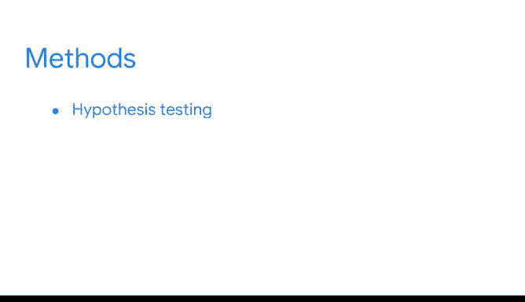

# 谷歌高阶数据分析4：《统计的力量》the-power-of-statistics（中英双字） - P4：04_01_06_统计学在数据科学中的角色.zh_en - GPT中英字幕课程资源 - BV1yk4y1G7Qm

Earlier， you learned that statistics is the study of the collection。

 analysis and interpretation of data Today day， humans generate and collect more data than ever before。

 When we send a text message， make a purchase online or post a photo on social media。

 we generate new data as the amount of data grows。 So does the need to analyze and interpret it。

 This is a big reason why stats and data driven work is so important。

And the field of data analytics is growing almost as fast as the data itself Data professionals use statistics to analyze data in business。

 medicine， science， engineering， government and more。In this video。

 we'll discuss the role of statistics in data science and why learning fundamental stats concepts is essential for every data professional data professionals use the power of statistical methods to identify meaningful patterns and relationships and data。

 analyze and quantify uncertainty， generate insights from data。

 make informed predictions about the future and solve complex problems。

Even if you've never studied statistics， you probably use stats daily。 For example。

 you may start your day by going online and checking the weather where you learn that this forecast is for a 70% chance of rain or a 50% chance of snow。

 Perhaps you visit a sports website to learn the batting average of your favorite cricket player or the scoring average of your favorite basketball player on a news app。

 you might come across an election poll that reports a 3% margin of error and notes that an online survey was used to collect the data。

 or perhaps you're a parent And when you take your child to their yearly checkup。

 you learn that your child is in a certain percentile for height and weight。

When you ask for more information， the doctor shows you the median height and weight for all kids who are the same age。

 These scenarios include statistical concepts that you'll learn more about in this course。

 The weather report is based on probability or the likelihood of an event。

 The sports stats express average value。 The election poll shows margin of error。

 The doctor uses the concepts of percentile and median。

 and all these stats give you useful knowledge that you can apply to your own life。

Data professionals use the same concepts in their work。 For example。

 a data professional might use probability to predict the future rate of return on an investment。

They might estimate the annual average sales revenue for a company。

 calculate the margin of error to quantify the uncertainty of an employee satisfaction survey or use percentiles to rank medium home prices in different cities。

 On the job， data professionals use stats to transform data into insights that help stakeholders make decisions。

 Statistics is the foundation of data analytics and is the basis for the most advanced methods of analysis that data professionals use。

 And it all begins with the fundamental concepts that we are exploring in this course。

Consider the role grammar plays in your conversations。 For example。

 when you chat with friends or coworkers， you're probably not thinking about grammatical concepts like the parts of speech。

If you're having a conversation， then you already know how to use nouns， verbs and adjectives。

 Knowledge of basic grammar makes it possible to use language in the first place。

 This is why it's so foundational。In a similar way。

 shared knowledge of basic statistics allows data professionals to use a common language。

 learning that basics will eventually let you join the conversation about more advanced topics。

You'll build on your foundation and statistics with more complex methods like hypothesis testing。

 classification， regression and time series analysis。

 I hope you're getting excited about how data professionals use stats to make sense of their data and gain useful knowledge。

 Coming up， you'll get a chance to check out an example of stats in action。😊。

