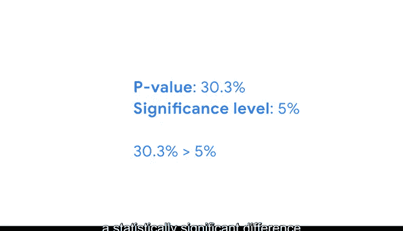

# 谷歌高阶数据分析4：《统计的力量》the-power-of-statistics（中英双字） - P50：50_05_03_双样本比例检验.zh_en - GPT中英字幕课程资源 - BV1yk4y1G7Qm

Recently， you learned that data professionals use a two sample T test to compare two population means。

 For example， we conducted a two sample T test to compare the mean time spent on two different versions of a landing page for cosmetics company In this video。

 you'll conduct a two sample Z test to compare two population proportions。

 recall that for technical reasons， T tests do not apply to proportions。

A data professional might use a two sample Z test to compare the proportion of defects among manufacturing products on two assembly lines。

 side effects to a new medicine for two trial groups。

 support for a new law among registered voters in two districts。Let's explore an example。

 Imagine you're a data professional working for an international construction company。

 The company has offices in London and Beijing。 The human resources team would like to determine whether there is a difference in the level of employee satisfaction between the Beijing office and the London office。

 The team surveys a random sample of 50 employees in each office to discover if they are satisfied with their current job。

 They ask you to find out if there's a statistically significant difference in the proportion of satisfied employees in London and Beijing。

 If so， the HR team will devote resources to investigating why employees at one office are more satisfied at work。

😊，According to the survey results，67% of the employees in the London office report being satisfied with their job。

 and 57% of the employees in the Beijing office report being satisfied with their job。

 There's an absurd difference of 10 percentage points or 67-57 between the proportion of satisfied employees in London and Beijing。

 You decide to conduct a two sample Z test to analyze the data。

Let's review the steps for connecting a hypothesis test。 First。

 state the null hypothesis and the alternative hypothesis。 Second， choose a significance level。

 third， find the P value， fourth， reject or fail to reject the null hypothesis。First。

 state your nu hypothesis and alternative hypothesis。In a two sample Z test。

 the null hypothesis states that there is no difference between the proportions of your two groups。

 This is assumed to be true unless there is convincing evidence to the contrary。

So for your hypothesis， you say there is no difference in the proportion of satisfied employees in London and Beijing。

Your alternative hypothesis will state the opposite claim。For your alternative hypothesis。

 you say there is a difference in the proportion of satisfied employees in London and Beijing。Next。

 set the significance level or the threshold at which you will consider a result statistically significant。

This is the probability of rejecting the null hypothesis when it is true。

 you choose a significance level of 5%， which is the company's standard for employee surveys。

Now find the P value In this case， your P value is the probability of observing a difference in your sample proportions as or more extreme than the difference observed when the null hypothesis is true。

Based on your sample data， the difference between the proportion of satisfied employees in London and Beijing is 10 percentage points。

Your null hypothesis claims that this difference is due to chance。

 Your P value is the probability of observing an absolute difference in sample proportions。

 That is 10 percentage points or greater。 if the null hypothesis is true。

 If the probability of this outcome is very unlikely。 in particular。

 if your P value is less than your significance level of 5%。

 then you will reject the null hypothesis。As a data professional。

 you'll almost always calculate P value on your computer using a programming language like Python or other statistical software。

To find your P value， first calculate your test staistic Z。

Use the following formula to calculate the Z statistic based on your sample data。

 Z equals P1 hat minus P2 hat divided by the square root of P0 hat times open parentheses。

1 minus P0 hat， close parentheses， times Oum parentheses。

1 divided by N1 plus1 divided by N2 close parentheses。

Where P1 hat and P2 hat are the sample proportions for your first and second group。

 and1 and N2 are the sample sizes for your first and second group。

 and P0 hat is the pooled proportion。The pooled proportion is a weighted average of the proportions from your two samples。

 This has a separate formula that you don't need to worry about right now。

If you enter the numbers in the formula and do the calculation， you get a z score of 1。

03 for a Z test， the test statistic follows a normal distribution under the null hypothesis。

 recall that your alternative hypothesis states that there is a difference in the proportion of satisfied employees in London and Beijing。

The observed difference is 10 percentage points。 So if you find a statistically significant difference between the two proportions。

 either less than or greater than the observed difference of 10 percentage points。

 you will reject the null hypothesis。Because you're interested in values in both directions。

 either less than or greater than your test statistic。

 your P value is the probability of getting a value less than the Z score negative 1。

03 or greater than the Z score positive 1。03。Your B value corresponds to the area under the curve on both the left tail and the right tail of the distribution。

This is a two tail test。 If you calculate the P value， you'll find that it's 0。3030。 or 30。3%。

 This means that there's a 30。3% probability that the absolute difference between the proportion of satisfied employees in London and Beijing would be 10% or greater if the null hypothesis is true to draw a conclusion。

 compare your P value with the significance level。 If your P value is less than the significance level。

 you conclude that there is a statistically significant difference in the proportions between the two groups。

 In other words， you reject the null hypothesis。If your P value is greater than their significance level。

 you conclude that there is not a statistically significant difference in the proportions between the two groups。

 In other words， you fail to reject the nu hypothesis。UP value of 0。3030 or 30。

3% is greater than the significance level of 0。05 or 5%。

So you fail to reject the null hypothesis and conclude that there is not a statistically significant difference between the proportion of satisfied employees in the London office and the Beijing office。

In other words， the observed difference in proportions is likely due to chance。

Your analysis will help the human resources team save a lot of time and money since there's not a difference in employee satisfaction between the two offices。

 the HR team will not have to devote resources to investigating the reasons behind the difference。

 however， they may want to find out how to make the employee satisfaction level a bit higher。

