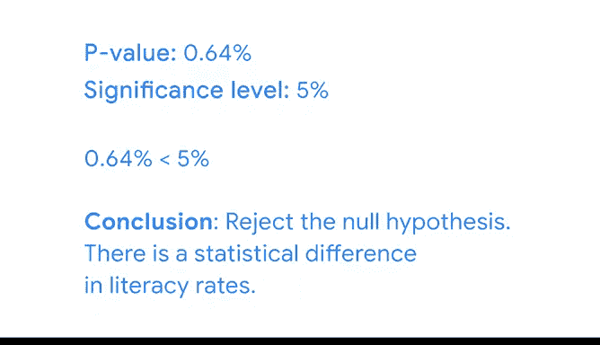

# 谷歌高阶数据分析4：《统计的力量》the-power-of-statistics（中英双字） - P51：51_05_01_使用Python进行假设检验.zh_en - GPT中英字幕课程资源 - BV1yk4y1G7Qm

Recently， we talked about how did professionals use two sample hypothesis tests to determine whether the difference between two sample means is statistically significant or due to chance。

Two sample tests are especially useful for AB tests。

 which often sample two groups of users to compare how they respond to different versions of a product or a website。

For instance， NAB test can help you decide if an observed difference in the average click rates is due to a specific change in website design or due to chance。

In this video， you'll use Python to connect a two sample T test based on sample data。

Python is helpful for conducting hypothesis tests with speed and accuracy。

 We will continue with our scenario from an earlier part of the course in which you are a did professional working for the Department of Education of a large nation。

Recall that you're analyzing data on the literacy rate for each district。

You'll continue to use the data you worked with before if you need to access the data。

 do so now for this video we'll make a new change to our story。

 imagine that the Department of Education asks you to collect data on mean district literacy rates for two of the nation's largest states。

 State 21 and state 28 State 28 has almost 40 districts and state 21 has more than 70。

Due to limited time and resources， you are only able to survey 20 randomly chosen districts in each state。

The Department of asks you to determine if the difference between the two mean district litacy rates is statistically significant or due to chance。

This will help the department decide how to distribute government funding to improve literacy。

If there is a statistically significant difference。

 the state with a lower literacy rate may receive more funding。

You can use Python to simulate taking a random sample of 20 districts in each state and conduct a two sample T test based on the sample data。

Let's open up a Jupyter notebook and get started。Import the Python package you will use Padas to save time。

 rename your package with an abbreviation PD。To load the Sippi stats module right from sippi import stats to start。

 filter your data frame for the district literacy rate data from the states' state 28 and state 21。

First， name a new variable， state 21。Then use the relational operator for equals to get the relevant data from the state name column。

Now name another variable， state 28。Folold the same procedure to get the relevant data from the state name column。

Now that you've organized your data， use Python to simulate random sampling。

Use the sample function to take a random sample of 20 districts from each state。 First。

 name a variable called sampled， underscore state 21。

 then enter the arguments of the sample function and the sample size equals 20 replace equals true because your sampling with replacement for random underscore state Cho an arbitrary number for the random seed to start the computer's random number generator。

 How about 13490 recall that using the same random seed lets you generate the same set of random numbers in case you want to return to this sample data in the future。

 Now， name another variable， sampled， underscore state 28， fall the same procedure。

 But this time choose a different number for the random seed。 How about 39103。

 You now have two random samples of 20 districts， one sample for each state。Next。

 use the mean function to compute the mean district literacy rate for both state 21 and State 28。

State 21 has a mean district literacy rate of about 70。8%。

 while state 28 has a mean district literacy rate of about 64。6%。Based on your sample data。

 the observed difference between the mean district literacy rates of state 21 and state 28 is 6。

2 percentage points， or 70。8-64。6。 At this point， you might want to conclude that state 21 has a higher overall literacy rate than state 28。

 However， you don't want to assume the results of your hypothesis test ahead of time。

The observed difference in your sample might be due to chance or sampling variability。

 In other words， the difference might not be due to an actual difference in the corresponding population means。

Is the observed difference statistically significant or due to chance？

Your hypothesis test will help you determine the answer。

Now that you've organized your data and simulated random sampling。

 you're ready to conduct your hypothesis test。Recall that the two sample T test is the standard approach for comparing the means of two independent samples。

 Let's review the steps for conducting a hypothesis test。 First。

 state the null and alternative hypothesis。Second， choose a significant level。Third。

 find the P value。Fourth， reject or fail to reject the no hypothesis。First。

 state your null hypothesis and alternative hypothesis in a two sample T test。

 the null hypothesis states that there is no difference between the means of your two groups。

This is assumed to be true unless there is convincing evidence to the contrary。

 So for your null hypothesis， you say there is no difference in the mean district literacy rates between state 21 and state 28。

 Your alternative hypothesis will state the contrary claim。

 There is a difference in the mean district literacy rates between state 21 and state 28。 Next。

 set the significance level or the threshold at which you will consider a result statistically significant。

 This is the probability of rejecting the null hypothesis when it is true。

The Education Department asks you to use their standard level of per 5% or 0。05。 Now。

 compute the P value。 In this case， your P value is the probability of observing a difference in your sample means as or more extreme than the adifference observed when the null hypothesis is true。

Based on your sample data， the difference between the mean district litacy rates of state 21 and State 28 is 6。

2 percentage points。Your null hypothesis claims that this difference is due to chance。

Your P value is the probability of observing an absolute difference in sample means that is 6。

2 or greater if the null hypothesis is true。If the probability of this outcome is very unlikely。

 in particular， if your P value is less than your significance level of 5%。

 then you will reject the null hypothesis。For a two sample T test use the spi function。

 stats dot T test underscore end parentheses to compute your P value。

 This function includes the following arguments。 A refers to observations from your first sample。

B refers to observations from your second sample。 Equal underscore var is a boolean or true false statement。

 which indicates whether the population variance of the two samples is assumed to be equal In our example。

 you don't have access to data for the entire population so you don't want to assume anything about the variance to avoid making a wrong assumption。

 set equal underscore var to false。Now you're ready to write this all out in code。

Start with the stats dot T test underscore in function， and enter the relevant arguments。 A。

 your first sample refers to the district literacy rate data for state 21。

 which is stored in the overall literacy column of your variable， sampled underscore state 21。B。

 your second sample refers to the district literacy rate data for state 28。

 which is stored in the overall literacy column for your variable， sampled， underscore state 28。

Set equal underscore bar to false because you don't want to assume that the two samples have the same variance。

Now run the code， The output confirms your P value is about 0。0064 or 0。64%。

This means there is only a 0。64% probability that the absolute difference between the two mean district literacy rates would be 6。

2 percentage points or greater if the null hypothesis is true。 In other words。

 it's highly unlikely that the difference in the two means is due to chance。 to draw a conclusion。

 compareare your P value with the significance level。 Remember。

 if your P value is less than the significance level。

 you conclude that there is a statistically significant difference in the mean district literacy rates between state 21 and state 28。

In other words， you reject the null hypothesis。 If your P value is greater than the significance level。

 you conclude that there is not a statistically significant difference in the mean district literacy rates between state 21 and state 28。

 In other words， you fail to reject the null hypothesis。 Your P value of 0。0064 or 0。

64% is less than the significance level of 0。05 or 5%。

So you reject the null hypothesis and conclude that there is a statistically significant difference between the mean district literacy rates of the two states。

 state 21 and state 28。

Your analysis will help the department decide how to distribute government resources since there is a statistically significant difference in mean district literacy rates。

The state with the lower literacy rate， state 28， will likely receive more resources to improve literacy。

The two sample TT is a powerful tool for investigating the differences between two sample means。

 and data professionals often use T tests to help stakeholders make data driven decisions。

