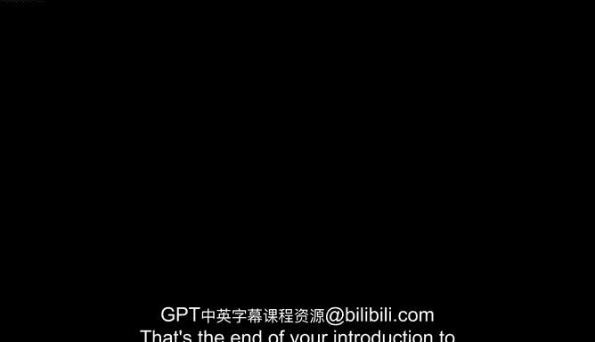
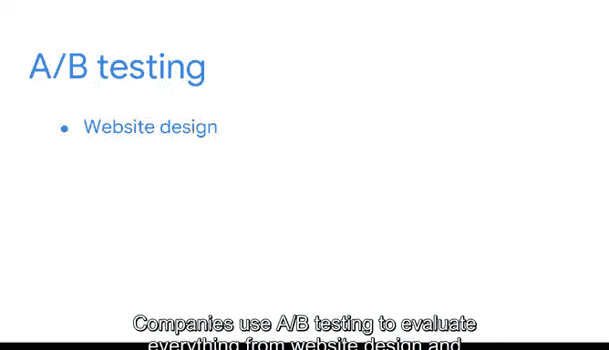

# 谷歌高阶数据分析4：《统计的力量》the-power-of-statistics（中英双字） - P52：52_05_01_总结_5.zh_en - GPT中英字幕课程资源 - BV1yk4y1G7Qm

That's the end of your introduction to hypothesis testing in your future career as a data professional。

 you'll conduct hypothesis tests to help determine the statistical significance of your results。

To start， we went over the general procedure for hypothesis testing。

 from stating yourinnal hypothesis and alternative hypothesis to choosing your significance level。

 finding your P value， and rejecting or failing to reject yourin nu hypothesis。

Then we explored two different types of hypothesis tests， one sample and two sample。

 to understand how one sample hypothesis tests work。

 we conducted a one sample Z test to analyze data on the mean delivery time of an online food delivery service。

Then to explore the two sample tests， we conducted a two sample Z test to compare the proportion of satisfied employees at two different offices at a construction company。

Finally， you learned how to use Python's sippi stats module to conduct a two sample T test to determine if the difference between two population means is statistically significant Data professionals often use two sample tests in the context of AB testing Compan use AB testing to evaluate everything from website design and mobile apps to digital ads and marketing emails In this part of the course。

 we've conducted a two sample T test to compare the mean time spent on two different versions of a landing page for the cosmetics company。

A B tests help business leaders optimize performance and improve customer experience。 Soon。

 you'll put your Python skills to work in the portfolio project。

 The project will feature a realistic scenario based on an A B test。 So you're well prepared。 Com up。

 you have a graded assessment to prepare。 check out the reading that lists all the new terms you've learned。

 and feel free to revisit videos， readings and other resources that cover key concepts。

 Congratulations on all your progress Well done。😊。

