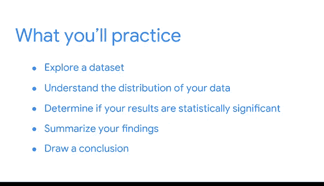

# 谷歌高阶数据分析4：《统计的力量》the-power-of-statistics（中英双字） - P53：53_06_01_欢迎来到模块六.zh_en - GPT中英字幕课程资源 - BV1yk4y1G7Qm

Hi there， it's Tiffany back again to talk to you about your portfolio projects and how you can use them in your job search。

Just like in your previous courses， you'll complete an independent project for your portfolio。

Completing this project is a great way to present your knowledge and experience about data centered tasks to potential employers。

This time， your project will demonstrate what you've learned about statistics。

This portfolio project is also an opportunity to develop your interview skills。

 as potential employers assess you as a candidate， they might ask for specific examples of how you tackle challenges in the past。

You can use your portfolio as a way to discuss data problems you have solved。

This project will help you consider how stats informs data professional work。

 and it will provide a concrete example for you to discuss in future job interviews。😊。

Some employers might also ask you to complete a specific task like an AB test。

In addition to having a portfolio， creating your own experimental designs means you'll be that much more prepared for those interviews。

Being able to use code and calculate formulas with statistical software is important for your future career and understanding how to apply those statistical models to a workplace problem is essential for success in the data career space。

To complete the portfolio project， you'll be presented with details about a business case。

 Then you will use the instructions to complete a new entry in your pay strategy document。

 S an A V test to compare two different versions of a product and choose the one that performs better。

You will use stats to explore a data set， understand the distribution of your data。

 and determine if your results are statistically significant。

Then you will summarize your findings in a quantitative way and draw a conclusion that ties back to the business problem。

By the time you complete this project， you'll have finished an AB test you can add to your portfolio。

In your pay strategy document， you'll also have a record of the steps you took along the way。

 which you can use to explain your work to future hiring managers。Ready。😊，Then， let's get going。

