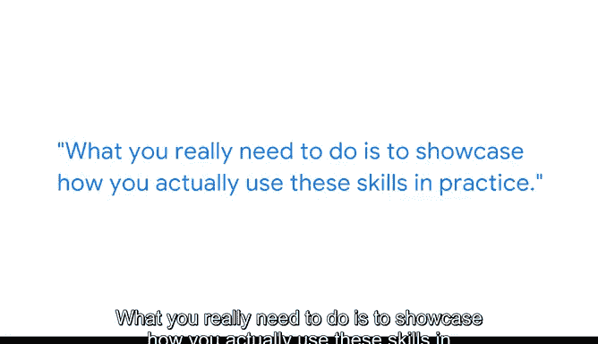

# 谷歌高阶数据分析4：《统计的力量》the-power-of-statistics（中英双字） - P54：54_06_02_Sean：向潜在雇主展示你的才能.zh_en - GPT中英字幕课程资源 - BV1yk4y1G7Qm

My name is Sean， I'm currently a product analyst at YouTube Shop。

 Pra analystly leverages the data that Google collects in order to understand better about how our users are doing using our products and if we can provide better services for them by making better product decisions using data。

What really got me into the advanced data analytics field was actually the cliche term big data back in high school。

 I thought that we could use big data to understand how this world functions and even predict the future and that was really fascinating for me when I was still a teenager。

When you're looking for a data science job， in my opinion。

 the most important things are the following。 Firstly。

 to showcase that you actually understand the theories as well as the practical or technical skills in data science。

 So when you're preparing for your proof of evidence。

 make sure that you have a Github link or a collection of past presentations that can showcase that you presented anything related to data science or data visualizations。

 when you are showcasing your statistical skills in your portfolio or your resume。

 it's really important to notice that these skills are easily accessible to people online So everybody can learn them from YouTube or from Cosera or any other online course platforms。

 What you really need to do is to showcase how you actually use these skills in practice For instance。

 try to explain what exactly the business problem or research problem you are trying to solve and try to explain how you decided to use whatever models or solutions for that problem Just knowing the theories or how to implement a model is not enough instead what you really need to showcase is that you actually understand why you're using these model。

In these situations and how you're applying it make sure that you always highlight what is the business or research objective for the problem you're trying to solve and then explain exactly how you apply that skills and how you evaluate the results。

 If you don't have a college degree in data science， don't worry。

 because the skills that you're learning from online is actually what is required in the industry。

