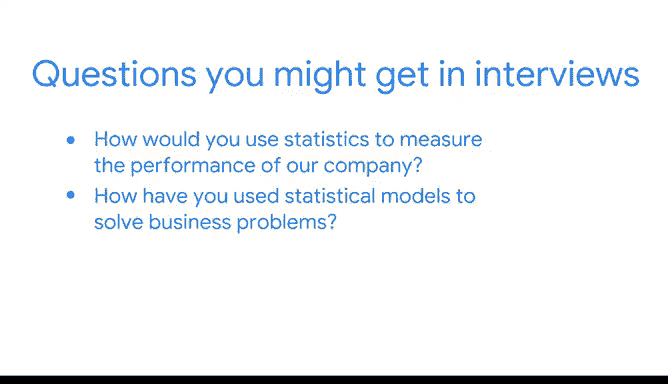

# 谷歌高阶数据分析4：《统计的力量》the-power-of-statistics（中英双字） - P56：56_06_01_期末项目总结与职业成功持续建议.zh_en - GPT中英字幕课程资源 - BV1yk4y1G7Qm

You're doing such a wonderful job， developing a comprehensive understanding of the way data is collected and analyzed to help inform business decisions。

 You've learned a lot about how to analyze data and use the inside data holds to help stakeholders develop a complete picture of the business situation at hand。

😊，At this point in the program， your portfolio now includes a new entry in your pace strategy document。

A tidy dataset set， visualizations that tell a story with data and a simulated A V test。

As you continue to work on other projects included in this program。

 your portfolio will continue to grow， demonstrating your progress， learning and skills。

Keep in mind that you're producing concrete examples that you'll want to discuss with potential employers and hiring managers during future interviews。

So far， you have reinforced your understanding of the importance of following the pace structure in a data career。

 observed how Python can help power data manipulation。

 as well as organize and analyze a data set to tell a compelling story。Plus。

 this section taught how to use statistics to explore any data set you're presented with or to analyze and interpret data you collected through sampling。

As you begin preparing for future interviews， it may be the case that you are asked。

How would you use statistics to measure the performance of our company。

How have you used statistical models to solve business problems。

What are the various factors that go into an experimental design for an A B test？

You might also be tasked with sharing details about a significant data project you worked on and how you use statistics to gain insights that benefited your team or organization。

In that case， the project you just completed would be great to talk about。

 You use Python to simulate an A V test for a specific scenario。😊，Keep in mind， too。

 that A B tests are used in many other contexts。All the same。

 A B tests generally call for similar methods since they serve to compare two versions of the same thing whether their product。

 website， email campaigns or the like。A key skill for many professions。

 including those in the data career space， is the ability to be flexible in applying your knowledge。

 You've already come so far in the data learning journey。 I'm proud of you Com up。

 you'll learn all about regression models。 Then you'll have an opportunity to demonstrate your understanding and assess a business scenario that requires a multiple linear regression model by creating a blog post By the end of this program。

 you will have a solid portfolio to demonstrate all you've accomplished。😊。

