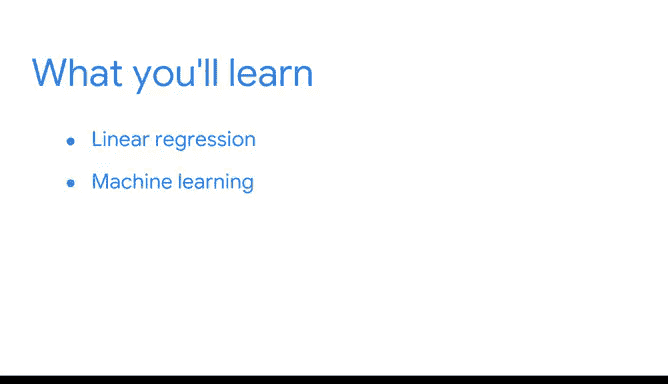

# 谷歌高阶数据分析4：《统计的力量》the-power-of-statistics（中英双字） - P57：57_06_02_课程总结.zh_en - GPT中英字幕课程资源 - BV1yk4y1G7Qm

Congratulations on completing the statistics portion of this program。

 Your knowledge of statistics gives you a solid foundation for learning more advanced methods of analysis as you progress in your career as a data professional。

😊，Your stat's knowledge will also serve you well in future job interviews。

 A strong understanding of fundamental stats concepts will make you a more compelling job candidate and a better data professional。

Earlier， I mentioned that being a data professional means continuing your learning journey throughout your career。

 And that's what I love about it。 Every time I encounter a new concept。

 I'm filled with a sense of excitement and renewed curiosity。😊。

Learning about advanced data analytics is like exploring an ever expanding universe。

 There are so many amazing new worlds to discover as the amount of data continues to grow。

 so does our knowledge about the best ways to analyze and interpret that data。

 I still spend a lot of time educating myself on the latest developments in machine learning。

 and reading about new ways to use statistical methods for data analytics。😊。

And now you've embarked upon that same learning journey。

 and you've already learned so much in this course。

 you've learned to calculate descriptive stats like the mean。

 median and standard deviation to explore and summarize a new data set。

Apply probability distributions like the binomial， Poson and normal distribution to model your data。

Use sampling distributions to make point estimates about population means and proportions。

Construct confidence intervals to describe the uncertainty of your estimates and conduct hypothesis tests to determine the statistical significance of your results。

Coming up， you'll continue to build on your stat's knowledge。In the next course。

 you'll add a powerful new tool to your analytics toolbox， a statistical method called regression。

After that， you'll get to explore the fascinating world of machine learning。

 Having made it through stats， you're well prepared for upcoming courses。

 I'm excited for you to begin working with your next instructor。

 You may remember them from the video that introduce this program。 My colleague Tiffy。

 who works at the intersection of data science and marketing here at Google。

 Tiffany will tell you all about regression and help you take your next step toward finishing this program。

 and pursuing your future career as a data professional。

 It's been an honor to join you on this stage of your learning journey。

 I wish you all the best for the next stage and beyond Good luck。😊。

