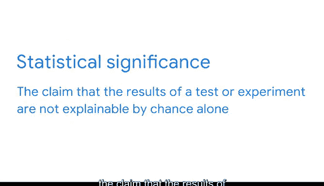

# 谷歌高阶数据分析4：《统计的力量》the-power-of-statistics（中英双字） - P5：05_01_07_统计学实践：AB测试.zh_en - GPT中英字幕课程资源 - BV1yk4y1G7Qm

Today's economy is all about data。 Business leaders want to make data driven decisions based on evidence and analysis。

 companies that use insights gained from data to guide their decision making process are more likely to be successful than companies that don't and data professionals are the people that generate those insights。

 These statistics to transform data into knowledge and help stakeholders make informed decisions。

 All the fundamental stats concepts that we cover in this course have valuable practical applications。

 In this video， you'll get a chance to check out stats in action。

 will go over one of the most popular applications of statistics for business A B testing。

I'll discuss how the stats concept you'll learn in this course can help you analyze and interpret data using an A B test。

 Companies use A B testing to evaluate everything from website design to mobile apps， to online ads。

 to marketing emails。AB testing is a way to compare two versions of something to find out which version performs better。

A B testing has become popular because it works well for many online applications。 For example。

 businesses often use A B testing to compare two versions of a web page to find out which one gets more clicks。

 purchases or subscriptions。 Even small changes to a web page like changing the color。

 size or location of a button can increase financial gains。

 A B tests help business leaders optimize product performance and improve customer experience。

Another way companies use A B testing is for marketing emails。

 You might send two versions of an email to your customer list to find out which version results in more sales。

 or you might test two versions of an online ad to discover which one visitors click on more often。

Once you've conducted the A P test， you can use the data to make permanent changes to your ad。

 Let's go through an example of an Ap test step by step。

 Imagine you run an online store and 10% of visitors to your website make a purchase。

 You want to run an A P test to find out if changing the size of the ad to cart button will increase the conversion rate。

 or the percentage of customers who purchase a product。

The test presents two versions of your web page known as version A and version B to a group of randomly selected users。

 Version A is the original web page。 Vision B is the web page with the larger add decarte button。

The test directs half the users version A and half to version B。 The test runs for two weeks。

 When the test is over， a statistical analysis of the results indicates that the larger button in version B resulted in an increase in purchases。

 The conversion rate for version B is 30%。 This is  three times greater than the conversion rate for version A。

 which is 10%。 That's a notable increase。 because of your A B test。

 your company has a data driven reason for replacing the current web page with version B and increasing the size of an ad tocart button。

 Now that you know how an A B test works。 Let's explore the stats concepts behind A B testing。

 Later on will cover each concept in more detail。 Think of this list as a brief preview of your future stats knowledge。

😊，The AB test analyzes a small group of users drawn from the total population of all users that visit the website in stats we call this smaller group the sample。

 the sample is a subset of the larger population， you can use data from a sample to make inferences or draw conclusions about the entire population。

Data professionals use inferential statistics to make inferences about a data set based on a sample of the data。

In other words， stats are a powerful tool for predicting outcomes you don't know using data you do know。

 For example， you have no way of knowing how the next 100000 website visitors will behave。

 What you can do is observe the next 100 visitors and then use inferential statistics to predict how the following 99。

000 will behave。And as you'll discover， stats can help you make that prediction with accuracy。

 This is why observing a sample through A B testing can be so valuable to companies。

 They can use the results of the test to make changes that improve their business。Sampling。

 the process of selecting a subset of data from a population is a critical part of an AB test。

Before you conduct the test， you need to decide on the sample size or the number of users in the test。

 Choosing the right sample size helps you get valid test results and avoid statistical errors。

 For example， you'll use stats to help you determine whether you need to use a sample size of 1000 or 10000 in order to predict customer behavior accurately。

 like any statistical test and a B test can't predict user behavior with 100% certainty。

 What stats can do is construct a confidence interval。

 or a range of values that describes the uncertainty or surrounding an estimate。

Knowing how to construct and interpret a confidence interval helps you make informed decisions about all users based on your test sample using stats。

 you can quantify the uncertainty of your AB test and share this information with stakeholders to help them interpret the results。

 We'll talk more about how to interpret a confidence interval later on。After the test is complete。

 you'll need to determine the statistical significance of your results。

Statistical significance refers to the claim that the results of a test or experiment are not explainable by chance alone。

For instance， is the difference between version A and version B due to random chance or due to the fact that you changed the add to cart button？

Iypothesis test is a statistical method that helps you answer this question。

The test helps quantify whether the result is likely due to chance or if it's statistically significant。

 A hypothesis test gives you data driven support for changing your web page to version B。

 or for keeping it the same with version A。Software can help you calculate complex math problems。

 but having a working knowledge of stats lets you properly design。

 conduct and interpret the results of a real test。By the end of this course。

 you'll know how to use all the stats concepts we just reviewed to analyze and interpret data。

 in fact， you'll be able to put your stat skills to work in a portfolio project based on a realistic AB testing scenario。

Plus， your knowledge of stats will serve as a foundation for more advanced data analytics methods that you'll explore later on。

