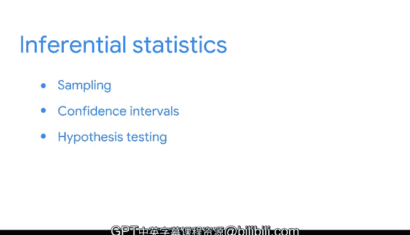

# 谷歌高阶数据分析4：《统计的力量》the-power-of-statistics（中英双字） - P6：06_01_08_描述性统计与推断性统计.zh_en - GPT中英字幕课程资源 - BV1yk4y1G7Qm

Now that you know more about the role of statistics in data science。

 let's discuss the two main types of statistical methods。

 descriptive and inferential data professionals use each method to get different insights from their data。

 In this video， you'll learn the difference between descriptive and inferential stats and how data professionals use both to better understand their data。

 Descriptive statistics， De or summarize the main features of a data set。

 Descriptive stats are very useful because they let you quickly understand a large amount of data。

 For example， let's say you had data on the heights of 10 million people。

 You probably don't want to scan 10 million rows of data to analyze it for your report。

 Even if you did， it would be difficult to interpret the data。 However， if you summarize the data。

 you can instantly make it meaningful。 Find the mean or average height gives you useful knowledge about the data。

 Plus， reading a sum much better than staring at millions of rows of data。

 They are two common forms of descriptive statistics。

 visualuals like graphs and tables and summary stats。Obviously。

 you learned how graphs and tables can help you explore， visualize and share your data。

 You're likely familiar with data visualizations such as histograms， scatter plots and box spots。

Summary statistics let you summarize your data using a single number。

 A common example is the mean or average value。 There are two main types of summary stats。

 measuresa of central tendency and measures of dispersion。 Measure of central tendency like the mean。

 Let you describe the center of your data， Measure of dispersion like standard deviation。

 let you describe the spread of your data or the amount of variation in your data points。

 Stats like mean and standard deviation are used to describe and summarize data。

 but data professionals do more than just describe their data。

 They also draw conclusions and make predictions based on data。For this。

 they use inferential statistics。 Inferential statistics allow data professionals to make inferences about a data set based on a sample of the data。

 The data set that the sample is drawn from is called the population。

 A population includes every possible element that you are interested in measuring。

 And as we've discussed， a sample is a subset of a population。

Data professionals use samples to make inferences about populations， in other words。

 they use the data they collect from a small part of the population to draw conclusions about the population as a whole。

Note that a statistical population may refer to people， objects or events。 For instance。

 a population might be the set of all residents of a country。

 All the planets in our solar system or all the outcomes of 1000 coin flips。

 A sample is a smaller group or subset of any of these populations。 Samles might be residence。

 planets or coin fliplip outcomes。 Let's check out an example。

 Say you want to research the music preferences of every college student in the United States to find out whether they prefer pop。

 rap， country， classicalical or another genre of music。

 There are around 20 million college students in the United States and would be too expensive and time consuming to gather data from every single person。

Instead， you can use a sample and survey only a subset of the 20 million students。 Later on。

 we'll discuss the factors that go into choosing different sample sizes and how larger sample sizes affect your results。

 For now， let's imagine you decide to survey 1000 students instead of 20 million。

 Then you can use the results to make inferences about the music preferences of all college students。

Keep in mind that your sample should be representative of your population。 Otherwise。

 the conclusions you draw from your sample will be unreliable and possibly biased。

 A representative sample is a sample that accurately reflects the population。 For example。

 if you only survey math majors or only student athletes。

 your sample will not be representative of all college students。 Finally。

 let's review two terms that correspond to population and sample。 parametermeter and statistic。

 A parameter is a characteristic of a population。 A statistic is a characteristic of a sample。

 For example， the average height of the entire population of giraffes is a parameter。

 The average height of a random sample of 10 giraffes is a statistic。As I mentioned。

 it's difficult to collect data about every member of a large population。 in this case。

 to locate and measure the height of every single giraffe in the world。

 So we use the known value of a sample statistic， the average of 100 giraffes to estimate the unknown value of a population parameter。

That's all for now。 We've covered a lot of key concepts that are foundational for what you'll learn later on in the course。

 Coming up， we will return to the topic of inferential statistics。

 We'll explore sampling in more detail and check out common methods of inferential stats such as confidence intervals and hypothesis testing。

