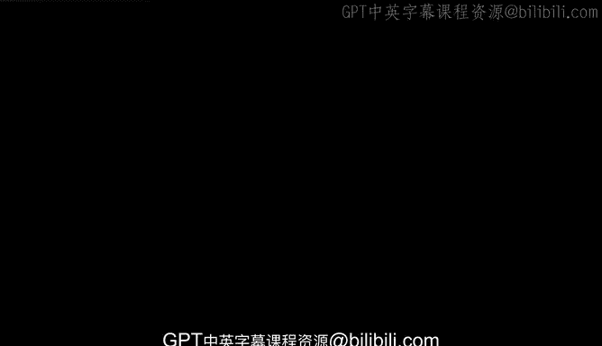
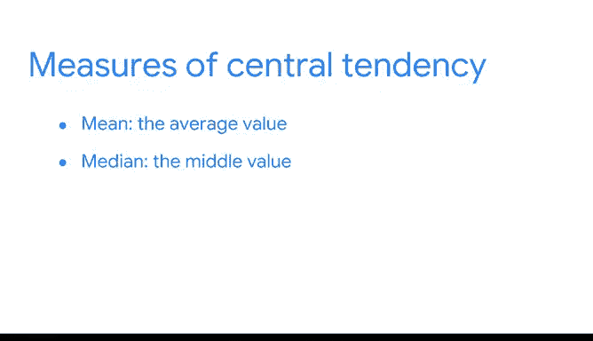

# 谷歌高阶数据分析4：《统计的力量》the-power-of-statistics（中英双字） - P7：07_01_01_集中趋势度量.zh_en - GPT中英字幕课程资源 - BV1yk4y1G7Qm

Every time I explore a new dataset set， I feel a sense of excitement。

 It's like exploring a city for the first time。 When I visit a new city。

 I often start my journey at the city's center。 This way。

 I can figure out the distance between the center and the city limits or to a famous landmark I want to visit knowing where I am in relation to the center helps me find my way around。

😊，It's the same1 I want to learn about a new dataset。 First， I want to know the center of my dataset。

 Then I want to know how spread out the other values are from the center。

 measuringuring the center and the spread of a dataset helps me quickly understand its overall structure and decide which parts I want to explore in more detail。

 Earl， you learn that summary statistics include measures of central tendency and measures of dispersion。

Measures of central tendency are values that represent the center of a data set。

Measures of dispersion are values that represent the spread of a data set。

 We'll talk more about measures of dispersion later on In this video。

 you'll learn how to calculate three measures of central tendency， The mean， the median and the mode。

 You may remember these terms from earlier in the program。

 but we'll discuss their importance in this study of statistics and data analysis。

 We'll also discuss which measure is best used based on your specific data。Let's start with the mean。

 The mean is the average value in a dataset set to calculate the mean。

 you add up all the values in your dataset and divide by the total number of values。 For example。

 say you have the following set of values，10，8，5，77 Def the mean you add up all the values for a total of 100。

 Then you divide by 5。 The total number of values。 The mean or average value is 20。Next， the median。

 the median is the middle value in a data set。This means half the values in the dataset set are larger than the median and half are smaller。

 You can find the median by arranging all the values in a data set from smallest to largest。

 If you arrange your five values in this way， you get 5，7，8，10，70。 The median or middle value is 8。

If there are an even number of values in your dataset set。

 the median is the average of the two middle values。 Let's say you add another value for to your set。

 Now， the two middle values are 7 and 8。 The median is their average，7。5。

You may notice that the mean 20 is much greater than the median 8。

 This is because there is one extreme value，70 that increases the overall average。

 This value is known as an outlier。 recall that an outlier is a value that differs greatly from the rest of the data as measures of central tendency。

 The mean and the median work better for different kinds of data。

 If there are outliers in your dataset， the median is usually a better measure of the center。

If there are no outlayers， the meme usually works well。For example。

 imagine you want to buy a home in a specific neighborhood。

 You tour 10 homes in the area to get an idea of the average price。

 The first 9 homes have a price of 100000。 The 10th home has a price of a million dollars。

 This is an outlier that pulls up the average。 If you add all the home prices and divide by 10。

 you find that the mean or average price is 190000。

 The mean doesn't give you a good measure of the typical value of a home in this neighborhood。

 In fact， only one home out of 10 costs more than $100000。The median home price is $100000。

 The median gives you a much better idea of the typical value of a home in this neighborhood。

 whether you use the mean or median depends on the specific data set you're working with and what insights you want to gain from your data。

Finally， we have the mode。 The mode is the most frequently occurring value in a data set。

 A dataset set can have no mode， one mode， or more than one mode。 For example， the set of numbers 1。

2，3，4，5 has no mode because there are no value repeats。 and the set 1，3，3，5，7。

 The mode is 3 because 3 is the only value that occurs more than once。 The set 1，2，2，4。

4 has two modes，2， and 4。The mode is useful when working with categorical data because it clearly shows you which category occurs most frequently。

 say an online retail company conducts a survey。  customers rate their experience as bad， mediocre。

 good or great。 A bar chart summarizes the results。The highest bar refers to the rating bad。

 This is the most frequently occurring value or mode。

 The mode gives the company clear feedback on customer satisfaction。To recap， the mean， median。

 and mode all measure the center of a data set in different ways。The mean finds the average value。

 The median finds the middle value， and the mode finds the most frequently occurring value。

 knowing the center of your dataset helps you quickly understand its basic structure and determine the next steps in your analysis。

 Just like knowing the city center helps orient you in a new environment。

