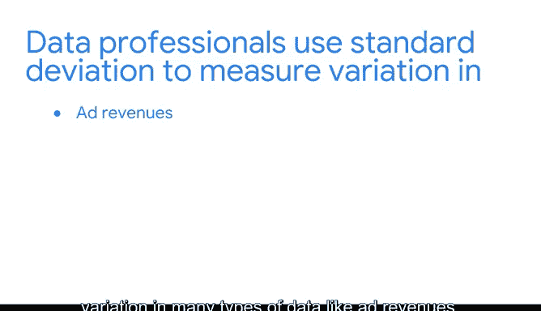
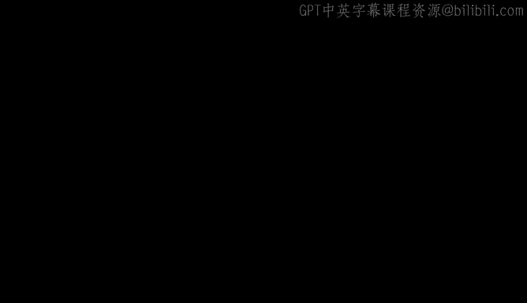

# 谷歌高阶数据分析4：《统计的力量》the-power-of-statistics（中英双字） - P8：08_01_03_离散程度度量.zh_en - GPT中英字幕课程资源 - BV1yk4y1G7Qm

As I mentioned earlier， there are two things I want to know when I begin to explore a new data set。

 First， the location of the center or the measures of central tendency， like the mean。 Second。

 I want to know how spread out the values are from the center or the measures of dispersion like the standard deviation to get a complete picture of the data。

 It's good to know both the center and the spread。For example。

 datas with the same central value can have different levels of variability or spread。

 Take three small data sets。 Each set has three values that add up to 90 Each set has the same mean。

90 divided by 3 equals 30， but the variation of values around the mean is much different。

 in the first set the values 25，30 and 35 are all close to the mean of 30。And the third set。

 the values 5， 10， and 75 are much more spread out from the mean。Earlier。

 you learned how measures of central tendency like mean。

 median and mode represent the center of your dataset。 Now you'll learn how measures of dispersion。

 such as the range and standard deviation can help you understand the spread of your data。

 The range is the difference between the largest and smallest value in a data。

Say you have data on the daily temperature in Fahrenheit for the city of Central Valley。

 Costa Rica for the past week， the highest temperature is 77 degrees。

 The lowest temperature is 67 degrees。 So the range is 10。

The range is a useful metric because it's easy to calculate and gives you a very quick understanding of the overall spread of your data。

However， standard deviation gives you a more nuanced idea of the variation in your data standard deviation measures how spread out your values are from the mean of your data set。

It calculates the typical distance of a data point from the mean， the larger the standard deviation。

 the more spread out your values are from the mean。Another measure of spread is called the variance。

 which is the average of the square difference of each data point from the mean。 Basically。

 it's the square of the standard deviation。 You'll learn more about variance and how to use it in a later course。

 Let's check out the plots of three normal probability distributions to get a better idea of spread。

Later on， you'll learn more about distributions which map all the values in a data set。 For now。

 just know that the mean is the highest point on each curve right in the center。

Each curve has a different standard deviation。 Blue is one， green is2， and red is3。

The blue curve has the least spread since most of its data points fall close to the mean。Therefore。

 the blue curve has the small standard deviation。The red curve has the largest standard deviation deviation。

It has the most spread since most of its data points fall farther away from the mean。Now。

 let's talk about how you determine with these numbers。

Here's the formula for the standard deviation of a sample。 In other words。

 the square root of sigma times open parenthesis， x minus x bar closed parenthesis squared divided by n -1。

If you're new to stats， this formula may seem like a secret code or an unfamiliar language。

 That's okay。 We'll go over the variables and formula step by step。 Plus。

 you don't need to memorize the formula or do all the math on your own As a data professional。

 you'll typically use a computer for calculations。Being able to perform calculations is important for your future career。

 but being familiar with the concepts behind the calculations will help you apply statistical methods to workplace problems。

There are different formulas to calculate the standard deviation for a population and a sample。

 As a reminder， data professionals typically work with sample data and they make inferences about populations based on the sample。

 so we'll review the formula for a sample， Let's consider how to interpret the formula by calculating the standard deviation of a small dataset set 8。

10 and 12。Calculating the standard deviation involves five steps。First， find the mean of the dataset。

 The mean equals 10 next for each value X in our data， we find the distance to the mean。

 and then we square it。We'll include that calculation in our next step。

The Greek letter sigma is a symbol that means sum。 So we need to do the x-10 squared calculation for each data point and add up all the results。

 That's 8-10 squared is 4，10-10 squared is 0， and 12-10 squared equals 4。

Add all those together to equal 8。Then divide that total by n-1。

 N refers to the total number of values in your dataset set， which is 3。 So 3-1 equals 2。

 Then are sum of 8 divided by 2 equals 4。 Finally， take the square root of 4。 That's 2。

 the standard deviation。 Now， let's explore an example of how standard deviation is useful in everyday life。

Meteorologists use standard deviation for weather forecasting to understand how much variation exists in daily temperatures in different places and to make more accurate predictions about the weather。

Imagine two meteorologists working in two different cities， city A and city B。

During the month of March， City A has a mean temperature of 66 degrees Fahrenheit and a standard deviation of three degrees City B has a mean temperature of 64 degrees Frenit and a standard deviation of 16 degrees。

Both cities have similar mean temperatures， in other words。

 the overall average temperature is about the same。

But the standard deviation is much higher in city B。

 This means there's more daily variation and temperature in city B。

 so the weather may change dramatically from day to day there in city A。

 the weather is more consistent。If the meteorologist in city B predicted the weather based on the mean。

 they could be off by 16 degrees， which would lead to a lot of unhappy residents。

 the standard deviation gives the meteorologist a useful measure variation to consider and a level of confidence about their prediction。

 a low standard deviation and temperature makes it a lot easier for the meteorologist in city A to accurately predict though daily weather。

Data professionals use standard deviation to measure variation in many types of data like ad revenues。

 stock prices， employee salaries， and more。

Now you have a better idea of how standard deviation measures the spread of your data Com up。

 we'll discuss some ways of understanding the relative position of the values in a data。

