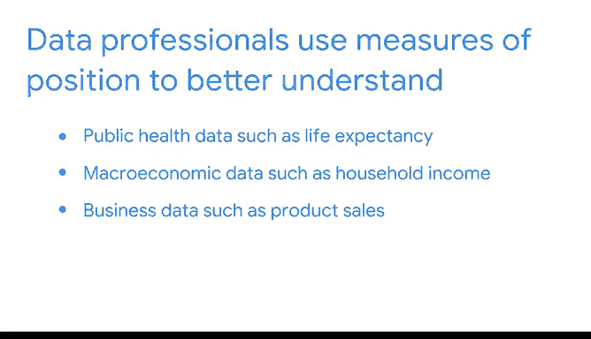

# 谷歌高阶数据分析4：《统计的力量》the-power-of-statistics（中英双字） - P9：09_01_05_位置度量.zh_en - GPT中英字幕课程资源 - BV1yk4y1G7Qm

By now， you've learned different ways to describe the center of your data with measures of central tendency。

 such as the mean and median。 You can also use measures of dispersion。

 such as the standard deviation to represent the spread of your data。

 These tools will help you explore and better understand any data set you may encounter。 Now。

 we'll finish our tour of descriptive statistics by checking out measures of position。

Measures of position help you determine the position of a value in relation to other values in a data set。

Along with center and spread， it's helpful to know the relative position of the values。 For example。

 whether one value is higher or lower than another or whether a value falls in the lower。

 middle or upper portion of your dataset。In a city。

 this is similar to knowing where different places of interest are located in relation to one another。

For example， it's useful to know how far the art museum is from the city park。

 or if the famous restaurant you want to eat at is close to the historical monument you want to visit。

In this video， you'll learn about the most common measures of position。Percentiles and quartiles。

 you'll also learn how to calculate the inter quartile range and use the five number summary to summarize your data。

 A percentile is the value below which a percentage of data falls。

 Percentiles show the relative position or rank of a particular value in a data set。

Some universities ask applicants to take standardized tests。 For example， in the United States。

 the SAT and the ACT are common exams。 When a student receives their test score。

 they usually also receive a corresponding percentile。 For example。

 let's say a test score falls in the 99th percentile。

 This means the score is higher than 99% of all test scores。 If a score falls in the 75th percentile。

 the score is higher than 75% of all test scores。 If a score falls in the 50th percentile。

 the score is higher than half or 50% of all test scores and so on。

Percentiles are useful for comparative values。 For example。

 different exams may have different scoring systems。

 SAT scores range from 400 to 1600 ACT scores range from 1 to 36。

 and a typical school exam in math or history may range from 0 to 100。

If you only know the raw scores for each test， say 1000 for the SAT， 20 for the ACT。

 and 70 for the school exam， you have no way of making a meaningful comparison。

If you know that all three test scores fall in the 50th percentile。

 then you can meaningfully compare student performance across the different exams。

You can use quartiles to get a general understanding of the relative position of values。

 a quartile divides the values in a data set into four equal parts。

Cortiles let you compare values relative to the four quarters of data。

 Each quarter includes 25% of the values in your dataset。

 The first quartile is the middle value in the first half of the data。 The first quartile。

 Q1 is also called the lower quartile。25% of the data points are below Q1 and 75% are above it。

 The second quartile is the median value in the set。 Q2 is the median。

50% of the data points are below Q2 and 50% are above it。

 The third quartile is the middle value in the second half of the data。

75% of the data points are below Q3 and 25% are above it。

 Note the relationship between quartiles and percentiles。 Q1 refers to the 25th percentile。 Q2。

 the 50th percentile and Q3 to the 75th percentile。 For example。

 say you're the manager of a sports team。 You have data that shows how many goals Each player on your team scored over the course of an entire season。

 You want to compare the performance of each player based on。Scoring。

You can calculate quartiles for your data using these steps。 First。

 arrange the values from smallest to largest 11，12，14，18，22，23，27，33。Second。

 find the median of your dataset set。 This is the second quartile Q2。

 There are an even number of values in the dataset set。

 So the median is the average of the two middle values，18 and 22， Q2 equals 20。Third。

 find the median of the lower half of your data set， this is the lower quartile Q1。Q1 equals 13。

Finally， find the meetingn of the upper half of your data set。 This is the upper quartile Q3。

 Q3 equals 25。Breaking the data into quartiles give you a clear idea of player performance。

 You now know that the lower quartile players scored 13 goals or less。

 and the upper quartile scored 25 goals or more。 In other words。

 the lower 25% of players scored 13 goals or less， and the upper 25% scored 25 goals or more。

The middle 50% of players scored between 13 and 25 goals。

The middle 50% of your data is called the Intercorrtile range or IQR。

 The intercorrtile range is the distance between the first quartile， Q1 and the third quartile Q3。

Technically， IQR is a measure of dispersion because it measures the spread the middle half or middle 50% of your data。

This is the same as the distance between the 25th and 75th percentiles， or between Q1 and Q3。

IQR is also useful for determining the relative position of your data values。

IQR equals Q3 minus Q1 In this case， Q3 equals 25 and Q1 equals 13， so IQR equals 12。Finally。

 you can summarize the measured divisions in your dataset with the five number summary。

 the five numbers include the minimum， the first quartile， the median or second quartile。

 the third quartile and the maximum。For your sports data， the five number summary is 11，13，2025，38。

 The five number summary is useful because it gives you an overall idea of the distribution of your data from the extreme values to the center。

 You can visualize it with a box plot。 The box part of the box plot goes from the first quartile to the third quartile。

 The vertical line in the middle of the box is the median。

 The horizontal lines on each side of the box known as whiskers go from the first quartile to the minimum value。

And from the third quartile to the maximum value。The following box plot shows the data on goals。

 We can find the values on the box plot and determine the inter quartile range。

 Q1 or the lower quartile equals 13。 Q3 or the upper quartile equals 25。

 The inter quartile range is the length of the box，25-13 equals 12。

Data professionals use measures of positions such as percentiles and quartiles to better understand all kinds of data。

This may include public health data such as life expectancy， economic data such as household income。

 business data such as product sales， and more。

That concludes our tour of descriptive Staistic Com up you'll use Python to compute descriptive stats and summarize a data set。

