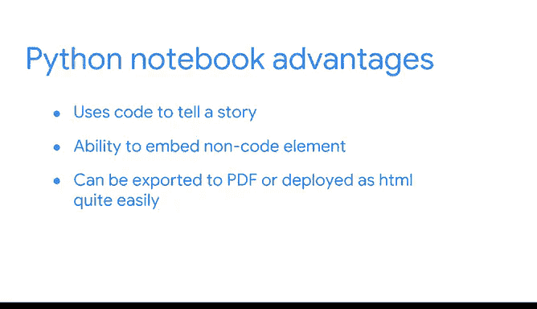

# 谷歌高阶数据分析6：《机器学习的基础知识》the-nuts-and-bolts-of-machine-learning（中英双字） - P10：10_01_01_机器学习中的Python.zh_en - GPT中英字幕课程资源 - BV1GW4y1o794

Today， there are many tools and programs that can help you perform data analytics and build machine learning models。

 Knowing what's available in your digital tool belt is important as you approach and solve problems as a data analytics professional。

😊，At YouTube， we need to wrangle vast quantities of data。

 rather than reinventing the wheel each time I use tools and libraries that other data professionals have already created to help me clean。

 validate and visualize my data efficiently。 You've been applying many of these tools throughout this program。

 But let's take a moment to review some of the software you've used some that you haven't and figure out how they relate。

 when creating any Pythonscript or program。 Development is almost always done inside an integrated development environment or IDdeE。

An IDE is a piece of software with an interface to write， run and test a piece of code。

 If you took the original Google data Analytic certificate。

 you coded using the language R and Rs accompanying IDE R Studio。

It's possible to create and run scripts inside any standard text editor。

 but IDEs provide many tools to support the development of your code。

You already used an Ide E in this program， maybe without even knowing it。

 you've coded in Python and executed that code within the Jupiter notebook interface。 In this case。

 Jupiter notebook is the IdeE。 For most coding languages。

 There are many Ides available to a developer。 They all perform similarly。

 with differences in functionality and included tools。

Selecting one will often depend on your personal preference or on your employer's preference。😡。

Later on， you'll learn more about Ides。 But for now。

 let's examine how they each handle different Python files。

 The two most common file types are Python scripts denoted with the extension dot pi and Python notebook files denoted with the extension dot I pi and B。

 depending on the task， a data professional might use both of these file types and may even alternate while working on one problem。

 Although both of these file types can execute code， they each have their own advantages。

It's important to remember that Python is not just a language used in data science。

 It's a flexible general purpose language that can be used for web development， automation。

 cryptography and other tasks many times， all you'll need is a Python script。

 Python script is the Python code written in a plain text file executed by the computer without the need for human supervision。

In situations when it's not necessary for a human to check the code while it's running。

 data professionals generally prefer to use Python script。

Scrips are especially useful when the program incorporates several files。

Scrips are also helpful when there are many errors in the program that require debugging。

 since scripts can take advantage of additional functionality that notebooks cannot。However。

 Python scripts typically aren't ideal for data science。 A data analytics professional。

 especially during EDA， needs to use Python to interactively explore a data set and view the outputs of their code in near real time。

Often， these results are shared with colleagues and must be in a human readable format。

Python notebooks are preferable for data tasks that use code to tell a story。

Notebooks can be really useful for pairing code with human readable descriptions and outputs。

 No code elements like images， linksnk and general text， can be embedded directly into the file。

 They also have some nice functional advantages， such as the ability to export the file as a P D F。

It might seem like dot pi files are preferable to dot i pi and B files。

 but that isn't necessarily true。Python notebooks are just another tool common in the data space。

 both for learners and industry professionals。 Many employers seek candidates who have experience working with existing Python notebooks and know how to create new ones。

You'll continue to use Jupiter notebooks for this part of the course。 However。

 all the code and concepts you've learned will work just as well in a standard dot P file if you're ever in a situation that requires that file type。

Python scripts， notebooks， and IDEs are just part of the tool belt。

Think of them as the foundation for the rest of the projects you'll be working on in this program and as a data professional。

 selecting the right combination of these tools will help you successfully complete any task you're given。

