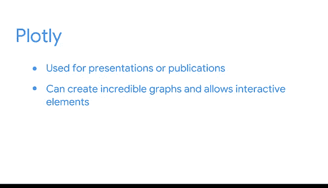

# 谷歌高阶数据分析6：《机器学习的基础知识》the-nuts-and-bolts-of-machine-learning（中英双字） - P12：12_01_04_深入理解Python包.zh_en - GPT中英字幕课程资源 - BV1GW4y1o794

Throughout this program， you've learned a lot about Python and its built in functions。

 You've also used some Python packages and libraries for coding。😊，If you recall。

 Python packages are a collection of modules that include functionality that is not necessarily present in the base Python language。

Modules are used to organize functions， classes， and other data in a structured way。

Libraries in Python are simply collections of packages。 In this video。

 you'll explore some common packages， including what they can do and how they can work together to help you accomplish a task。

Generally， there are three types of Python packages that you'll be using as a data professional。

 They can be used to accomplish the same tasks。 However。

 they often have small differences that can make one more useful， depending on the situation。

The first category we'll explore is operational packages。

 They're also the first packages you'll normally use in the analytical process。 Opera packages， load。

 structure and prepare a data set for further analysis。 When creating a Python file for analysis。

 The first thing you have to do is read in your data。

 The pandas package is often the most useful for doing this。 But the pandas read CV function。

 which reads your data into a data frame， is only a tiny percentage of what's included in the package。

 for efficient analysis and modeling， you can use functions that are built into the pandas package。

 This makes it easier to complete tasks， including preliminary data inspection。

 cleaning data and merging and joining the data frames。

 Other operational packages such as nu and si Pi provide functions for advanced mathematical operations。

 The second category is data visualization packages。

 There are many different packages that can help you create the perfect plots and graphs based on。😊。

The needs of a project while simple plotting functions exist across the most popular packages。

 there are small differences among them。 you should become familiar with as many as possible Mapllootlibb is usually the go to library for basic visualizations in Python It has a wide range of features and can be challenging to master。

 but is extremely powerful， allowing developers to create almost anything they can imagine。

Cborn is another visualization package that is focused on statistical visualization Sta visualizations are simple to create using Cborn。

 though it's not always possible or requires too much effort to create other types of plots。

Plootly is often used for presentations or publications。

 such as creating a data visualization for an interactive dashboard。

 It's similar to mappllootli in the sense that it can be challenging to master。

 but it can create incredible graphs and even allows you to add interactive elements to the visualizations。

😊。

The final category of packages used in this course are for machine learning PsK Learnear is a machine learning library that is built upon many of the packages we've already discussed。

This library enables you to build a variety of model types， both supervised and unsupervised。

 It also provides a great interface in which to analyze the results of a model。

Packages vastly expand the functionalities of Python。

 and experienced data professionals will use many of them in their work。

As you become more familiar with all of these exciting tools and features。

 you'll be even more prepared for a successful data career。

