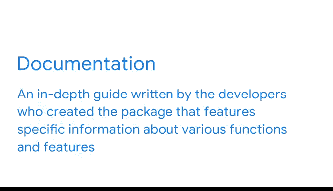

# 谷歌高阶数据分析6：《机器学习的基础知识》the-nuts-and-bolts-of-machine-learning（中英双字） - P13：13_01_01_解答编程问题的资源.zh_en - GPT中英字幕课程资源 - BV1GW4y1o794

Here's a little secret about the data field。 Almost no one knows what they're doing。100% of the time。

Even the most experienced professionals encounter issues with their code or the data analysis process itself and need to search for answers。

 that's why it's so important to understand the available resources that can help you find the solutions you need。

So let's consider a situation。 You just finished a piece of code and press the run button。

 but an error appears It could be a problem with the way you imported your data or something not totally correct in the way you prepared the data for analysis。

 What can you do， The first step might be searching for the error。

 As most problems will have been encountered by other developers before。

Python is particularly good at telling you where the error is， whether it's a simple syntax error。

 or some other exception。Your Ide E will often specifically identify the problem。

 along with the exact line number where it was caught。

 So take the error output and search for it online。 This usually yields some pretty helpful results。

 In fact， you'll often find your exact same error in the first few search results。

If you're not getting the help you need there， you can search on a public platform like stackck Overflow directly。

 Stack overflow is a go to resource for coding issues considered by many data professionals to be the definitive collection of coding questions and answers。

 Not only that， but the community is very responsive and helpful。

 so you should feel comfortable posting your own questions。

 Another resource that can be great is the documentation for the package or module you're working with。

 documentationcumentation is an in depth guide written by the developers who created the package。

 documentationcumentation features specific information about various functions and features and usually includes helpful examples。

😊。

Caggle is another resource that many data professionals use at some point in their journey。

 The online community features tens of thousands of public data sets。

 along with Python notebooks that provide examples of how to conquer a variety of analyses。

Many people who are just starting out in the data science industry use Cagle because it offers tutorials and data sets to learn and practice machine learning techniques。

 Data professionals who've been in the industry for many years also use Caggel to learn about new advances in technology and keep their skills sharp。

When you encounter an error message or other coding issue。

 it's also a best practice to consider whether your tools are up to date。

 Package updates can sometimes break pre existing code or change the way a particular function is accessed and used。

Your code will usually throw an error that tells you if a certain package or piece of software is out of date。

 but staying proactive can prevent the problems in the first place。

 So make sure you have correct versions of all your software and tools。

These resources are just a few to consider when you need help with your programming。

 you'll find developers collaborating all over the Internet。 and the more you learn。

 the easier you'll get to find solutions yourself。