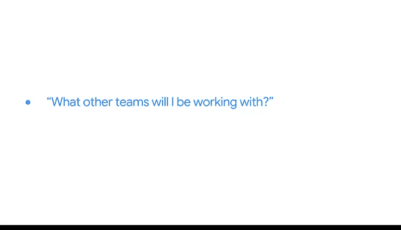

# 谷歌高阶数据分析6：《机器学习的基础知识》the-nuts-and-bolts-of-machine-learning（中英双字） - P14：14_01_03_你的机器学习团队.zh_en - GPT中英字幕课程资源 - BV1GW4y1o794

There's a lot of technology that helps you perform data tasks。

 and there's an extensive knowledge base online to reference whenever you have a problem during the process。

But it's equally important， especially when working in industry to know which team members can help you answer questions or solve problems。

 And this doesn't necessarily mean other data professionals。

 There are many stakeholders who contribute to data tasks。 Information technology teams。

 Business intelligence departments， and marketing professionals can all provide critical information。

 Compies often have their own specific tech， and the I T department can explain what's available for use。

 For example， if you realize you require a specific software or hardware to complete the problem you're working on。

 Then the I department can help you access what you need。

 Business intelligence teams take in raw data and make it accessible for further analysis。

 This could be in the form of dashboards for quick insights。

 or they may provide preliminary information about a data set。

 which you'll then use to inform your models。 There are also marketing departments。

 sometimes known as sales accounts， Inights or product management teams。 They can give you。

More of the why behind a particular analysis from a final product perspective。

 If you want to confirm that your data project is headed in the right direction。

 Check in with marketing can give you a clearer target to work toward。

In addition to those we've mentioned， there are many other teams you might consult。

 knowing the professionals who work adjacent to your project can help you tremendously。

 So learning about them is valuable whenever you start a new job。 Plus。

 the different teams at a workplace is something you can and should ask about in an interview situation。

 Que such as what other teams will I be working with or what resources are available if I encounter this issue can give you a great perspective on what your day to day work environment will be like。

😊。

Remember， data work is collaborative， your projects will always have other stakeholders involved。

 and you should be taking advantage of these key resources as much as possible。

