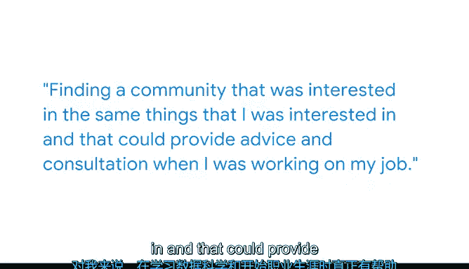

# 谷歌高阶数据分析6：《机器学习的基础知识》the-nuts-and-bolts-of-machine-learning（中英双字） - P15：15_01_04_Samantha-连接数据专业社区.zh_en - GPT中英字幕课程资源 - BV1GW4y1o794

Hi， I'm Samantha， and I'm a product analyst。 a product analyst is a data person who drives decision making on a product team。

 This can be working with the product managers to make sure that all of the decisions that they make are data drivenve and backed up by accurate data。

 I'm someone who's interested in a lot of things and finding this role in product analytics was perfect for me because it combines my interest in wanting to have a technical background with my interest in people。

 One of the cool things about data science is that it's a new and developing field and there's always new technology or new languages or new methodologies that are coming out。

 One of the best ways that I stay up to date is following data scientists on Twitter or looking at Reddit forums or following data science blogs。

 either put up by companies or by individual contributors being able to just find a place where you can chat with other data scientists or talk about problems。

You might be facing in your own projects I'm always referencing these blogs in case I want to find some methodology that I might not have thought of or some technique that might be helpful or just a little trick that you might not necessarily know just by reading a textbook and in my day to- day job I'll often look for libraries that some of these data scientists actually develop on their own and it will usually help me solve something that might not have been possible before Data science is traditionally a very academic field and there's a lot of。

Academic conferences that one can attend。 But one， I think that was great for those in the industry is the open data science conference Here。

 you'll find analysts， scientists， engineers from。Companies all around the world that will come together to learn about the latest technologies and network and get to know each other。

 This is a great opportunity to really meet other data scientists in the field。

 especially those that don't have the traditional backgrounds or titles of data scientists that you might see on a job posting。

 one of the things for me that really helped when I was learning data science and starting out for my careers。

 finding a community that was interested in the same things that I was interested in and that could provide advice and consultation when I was working on my job this can be anything from helping with recruiting and data science questions to answering coding problems that I might not have been able to find on the internet or even just finding people to work on projects with。

 having others to collaborate with can only help when completing your very first data science project。

😊。

