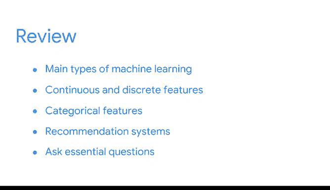

# 谷歌高阶数据分析6：《机器学习的基础知识》the-nuts-and-bolts-of-machine-learning（中英双字） - P16：16_01_01_总结_1.zh_en - GPT中英字幕课程资源 - BV1GW4y1o794

Take a moment to reflect on how far you've come。 We covered quite a few new and complex concepts。

 Let's review what you've learned。 You identified and differentiated the main types of machine learning。

 including supervised， unsupervised reinforcement and deep learning。

We discussed the difference between continuous and discrete features。

 You also learned about categorical features， which are finite sets of discrete features。

Then we provided an overview of recommendation systems and how they're useful for suggesting content from music to ice cream flavors。

 You're now familiar with how recommendation systems work。

 and you can identify the differences between content based and collaborative filtering。

 as well as their benefits and drawbacks。😊，Finally。

 you learned why it's important to be a responsible steward of data and how to ask essential questions at each step of model development。

😡。

By thinking through the ethical implications， you learned how to reduce the potential for your model to cause unintended or harmful consequences。

 All these concepts and skills are essential to a career as a data professional。

 Having this knowledge will be especially helpful as you continue in this course。😊，Coming up。

 you'll select machine learning models， learn ways to measure them and build the models in Python。

 These important skills will enable you to be a data driven story telleller。

 a powerful influencer of change wherever you work。 Congratulations。

 Me you in the next part of the program。😊。