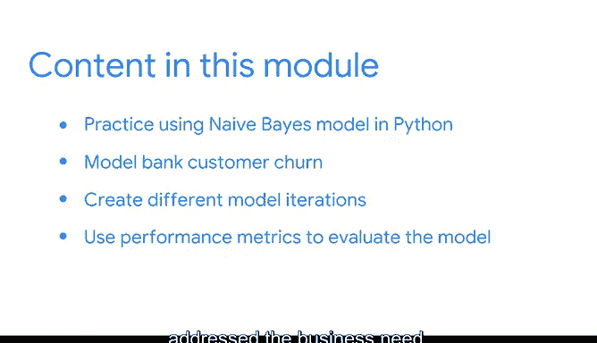

# 谷歌高阶数据分析6：《机器学习的基础知识》the-nuts-and-bolts-of-machine-learning（中英双字） - P18：18_02_02_机器学习中的节奏.zh_en - GPT中英字幕课程资源 - BV1GW4y1o794

Welcome back。 In this video， we're going to focus on the pace workflow for building effective models As a refresher。

 Pa consists of four stages。 plan， analyze， construct and execute。😊。

Pace helps guide the steps data professionals take as we align our data and models with the business needs。

 So， we'll use it to gain a more comprehensive understanding of the data and prepare it for modeling。

 using feature engineering and techniques to manage class imbalances。😊，From there。

 we'll practice a supervised learning model using Python called naive Base。

 The goal will be to model bank customer churn rate to predict whether a customer will close their bank account。

 In this context， churn is the rate at which customers stop doing business with a company over a given period of time and for continuous improvement will create different model iterations。

 Finally， we'll use performance metrics to evaluate how successfully the model addressed the business need。

😊。

Using the pace workflow not only provides a good baseline for approaching the problem。

 but also helps data professionals stay focused throughout the process by applying and referencing this framework。

 you'll have the skills to manage data driven problems in your career。 Ready， Let's go。

