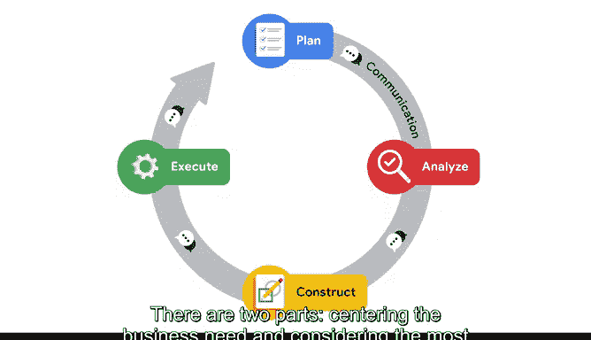

# 谷歌高阶数据分析6：《机器学习的基础知识》the-nuts-and-bolts-of-machine-learning（中英双字） - P19：19_02_03_规划机器学习项目.zh_en - GPT中英字幕课程资源 - BV1GW4y1o794

Happy to have you back。 I have a plan for this video。

 and the first part is discussing the plan step in pace。

 There are two parts centering the business need and considering the most appropriate machine learning model。

😊。

When using PAce， it's essential to align your plan with the business and data teams for machine learning。

 this means ensuring that the machine learning model you plan to construct meets the actual business needs。

This may seem a bit obvious， but given the potential complexity of the problem。

 multiple departments will likely be involved in the output。

 You also have to consider the data that's available to you before getting into the rest of the process of building the model。

Remember that you will most often be building models for a company or an organization because of that。

 you'll need to ensure that throughout the other stages of pace that your data modeling。

 metrics and optimizing strategies。 Stay focused on what you developed during the plan stage。

 Let's explore an example。 Suppose that your're working in the finance industry。

 and your firm is trying to predict housing prices。

 You have a massive data set about houses in a certain area。

 This data set contains information about the houses， such as square footage。

 The number of bedrooms and bathrooms and location。 Most importantly。

 the data set also contains the most recent sale price for each house。

As the second part of the planned stage of your paceworkflow。

 you use the context and requirements of the business need to consider what type of machine learning model would be best suited for the problem of predicting housing prices based on what you know of machine learning model so far。

 you need to create a supervised， continuous model to get the desired numerical result。

 Con models are the only ones that can help you predict housing prices for this example。

Now that you have your plan for the business problem and the scope for the machine learning model。

 you are ready for the next step。Analyze， see you soon。

