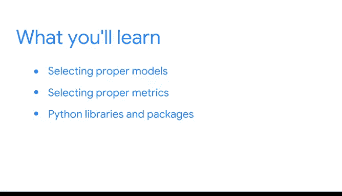

# 谷歌高阶数据分析6：《机器学习的基础知识》the-nuts-and-bolts-of-machine-learning（中英双字） - P1：01_01_01_课程介绍-6.zh_en - GPT中英字幕课程资源 - BV1GW4y1o794

Have you ever wondered how your Internet search browser predicts what you're about to ask。

 For instance， the algorithm knows that after you type will dinosaurs。

 there's a pretty good chance that next you'll type come back。

But how do programmers actually build a trained algorithm to make this kind of prediction？Well。

 in this course， you'll learn the process for creating complex models。

 which can be used to offer suggestions about all kinds of things。

 These models work by applying previously gathered data to make educated guesses。

About everything from dinosaurs to the music you listen to to the route you might take to work。

 and without talented data professionals and the machine learning models they create。

 we wouldn't have this useful feature throughout this course。 In addition to models。

 You will explore the major characteristics of machine learning and keep developing your skills in Python。

 But before we start， let me offer my congratulations on everything you've accomplished。

 You've practiced data cleaning， reviewed key statistics concepts and explored regression models。

 along the way， you've become better equipped to navigate the more complex parts of being a data professional。

 I will be your guide as we consider a big picture perspective of the world of machine learning and complex models。

 My name is Suila。 I'm a data scientist and I work on projects for YouTube here at Google。

 at YouTube， we use machine learning every day to deliver content to users from music reviews to travel vlogs to my personal favorite cat videos。

 I'm excited to explore machine learning。😊，With you， as you've learned previously。

 machine learning is the use and development of algorithms and statistical models to teach computer systems to analyze and discover patterns in data。

 Its applications are diverse from optimizing microchip design and improving earthquake predictions to recommending videos to watch on YouTube and more。

😊，This course will help you on your journey to becoming a data professional who can use machine learning to work on applications similar to the ones I just mentioned。

Before you begin， it may be helpful to review linear and logistic regression and statistical models covered earlier in this program。

 The terms complex models and machine learning are often used interchangeably。 In this course。

 when the term complex model is used We are referring to mathematical or computational models in general。

 inclusive of everything from regression to deep learning。 First。

 you'll learn the different types of machine learning， like supervised and unsupervised learning。

 Then you'll learn how to implement some of them。 Each type will be broken down by its characteristics so that the uses and purposes of each type are clear。

 Next， we'll consider another perspective of the data science workflow and discover how to apply pace to machine learning。

 In addition， you'll learn how exploratory data analysis or E relates to machine learning。

 you will also practice additional skills like feature engineering。

 another part of your introduction to the machine learning landscape will。😊。

Selecting relevant models and metrics。 you'll determine the most appropriate model for your purpose and data。

 You will learn which tools to use to evaluate your model's performance。

 You will also continue to work in Python。 Youll explore the most commonly used Python libraries and packages for specific types of machine learning。

 and you'll use the same resources that Google's data experts rely on in their work。

 By the end of this course， you will have a virtual tool belt packed with the tools you need to build and improve on complex models。

 Lastly， you will have the opportunity to practice your new job ready skills in a portfolio project that's based on a common workplace scenario for data professionals。

 Mach learning is an exciting field for data professionals。

 It's evolving and developing all the time with new applications every day。

 The concepts in this course will help prepare you to join the field and advance your career in data science。

😊。

