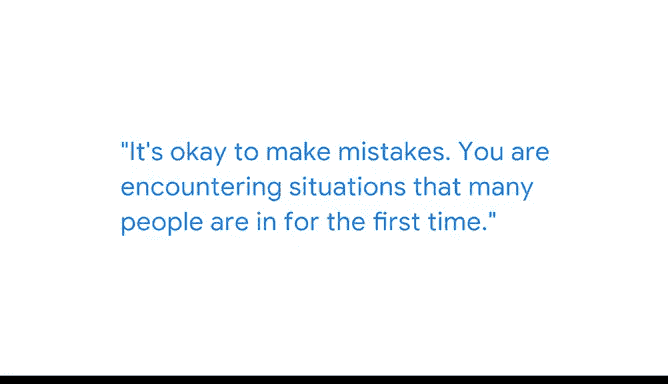

# 谷歌高阶数据分析6：《机器学习的基础知识》the-nuts-and-bolts-of-machine-learning（中英双字） - P20：20_02_05_Ganesh-克服挑战并从错误中学习.zh_en - GPT中英字幕课程资源 - BV1GW4y1o794

I'm Gnesh， I'm a group data science manager at Waymo so Waymo is a selfdriving card part of alphaphabet our goal is to automate driving for users so that they can just hail a card from anywhere。

 we can pick them up and go them drop off wherever we want to。

I manage a team of data scientists whose main goal is to figure out opportunities for optimization in improving the processes at Wemo every day is a new challenge because today you are working on one problem tomorrow is completely different and part of the charter that my team does is run experiments for Wemo So whenever someone thinks of a process change or whenever whenever someone wants to launch a new feature reduce experiments or AB test as you call it to figure out is this change truly helpful。

 is it working what is expected impact we're going to get from these changes So there was this time where we were conducting an AB test to measure the improvements that a process is going to have。

We had a control group who was doing the old process。

 and then we had a test group who was doing the new process。

 We were expecting a lot of improvements to come from that because we were super sure。

 we did some demos， and we thought that the new process is significantly better than the old process。

 But when we launched it， nothing really happened。 We waited。 nothing happened again。

This was hard because a lot of program managers， a lot of product managers have put their effort into this。

We did some field studies to go and see why it was wrong。

The users were so accustomed to the old process that they weren't willing to try the new process at all。

 They were going back to the old ways。 And that's why our test wasn't performing as expected。

That was a learning moment for us。 And for me， especially， right。

 because this is a big part of launching an A B test。

And that's when I realized that you don't want to launch process changes with existing users or customers。

 It's always good to use your new users to try these new processes。

 because that way you get an unbiased opinion of what is happening。

 and that way you can truly measure the impact of your new process。 I mean。

 had the problem not been resolved。 we would have we would have thought that the new process is bad and not launched a thing that is truly helping the company。

 So resolving this， figuring out what the problem was made sure that we didn't throw with that and we launched something that was truly important for the company。

 It's okay to make mistakes。 you're encountering situations where many people are in for the first time。

 So it's okay。 it's okay to ask for help。 it's okay to make those mistakes。

 But the big part is we shouldn't be repeating those mistakes again and again。

 So having this learning mentality of trying and doing iss gonna be the most important thing that any data centers has to。

