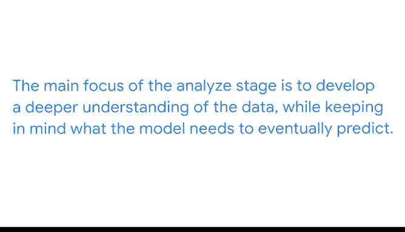

# 谷歌高阶数据分析6：《机器学习的基础知识》the-nuts-and-bolts-of-machine-learning（中英双字） - P21：21_02_06_为机器学习模型分析数据.zh_en - GPT中英字幕课程资源 - BV1GW4y1o794

Earlier， we explored the plan stage of our pace framework。

 Now that you've finished preliminary planning， it's time for the analyzed stage of pace。

 While keeping the business need in focus is particularly true for the plan stage。

 It's also essential throughout the process of developing a machine learning model。

 The business need informs a data professional on what the model needs to produce。

 The result indicates what type of model is required。

The business need also informs data professionals about the data that's necessary to train the model to achieve the desired result。

 The main focus of the analyzed stage is to develop a deeper understanding of the data。

 While keeping in mind what the model needs to eventually predict。 For example。

 if you're creating a supervised learning model， the first thing you'll need to know is what your model is trying to predict。

 In other words， you'll need to understand your response variable。

 you've already done this earlier in the course when you were deciding which type of supervised learning model to use。

 continuous or categorical。

Let's use weather as an example。 If you need to predict the exact amount of precipitation in inches。

 you'll probably go with a continuous model。 But if the business needs a model that can predict whether it will be rainy。

 cloudy or sunny， that requires a categorical model。Often， as a data professional。

 your data isn't structured exactly the way you need it to be。

This is where you can take advantage of many of the exploratory data analysis principles you learned earlier。

You'll be using all the techniques you learned so far to develop an understanding of what data you have available and how it's structured。

Let's return to the continuous model example about predicting precipitation in inches In your dataset set。

 the rainfall amounts that were recorded might not be in the exact units needed。

 or the data could be split between rain， snow and other types of precipitation。

 These are all details that a data professional needs to analyze before building the model itself。

 for the categorical model example where you're predicting whether it's rainy， cloudy or sunny。

 Your data set might not be labeled with the categories you need。

 The individual days in the data set might be labeled with only cloud cover metrics。

 which is something you'll have to change to be able to analyze the results effectively。

After getting a solid understanding of what your response variables are and how they're structured。

 the next step is exploring your predictor variables。

 Understanding the relationships that exist between variables in your dataset set is essential to building a model that will produce valuable results。

Similar to the response variables， the predictor variables might not be in the format or style that you want。

 In those cases， the same considerations apply。 You'll need to figure out how you want your data structured before building your model。

 This process of carefully considering the variables you have and what you need leads into the next part of the analyzed stage。

 feature engineering。Coming up， you'll learn about feature engineering。

 various techniques that are available， which scenarios to use them in。

 and what they can do for your data。