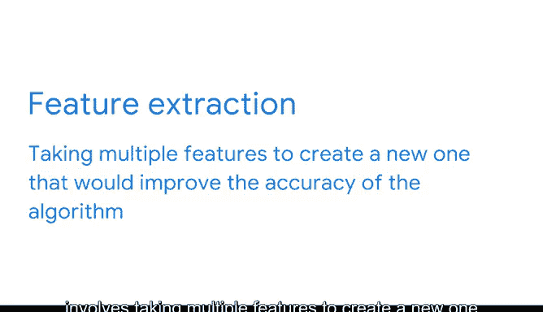

# 谷歌高阶数据分析6：《机器学习的基础知识》the-nuts-and-bolts-of-machine-learning（中英双字） - P22：22_02_07_特征工程入门.zh_en - GPT中英字幕课程资源 - BV1GW4y1o794

Welcome back。Previously， you learned that the main focus of the analyzed stage is to develop a deeper understanding of the data。

 carefully considering the variables you have and what you need leads into the next part of the analyzed stage。

 feature engineering。Feature engineering techniques solve the problems in how your data is structured and if done well。

 can improve your model's performance。In this video， you'll learn more about feature engineering。

 how it works， and when to use it。Feature engineering is the process of using practical， statistical。

 and data science knowledge to select， transform， or extract characteristics， properties。

 and attributes from raw data。This definition has quite a bit to consider。 First。

 the process of feature engineering is highly dependent on the type of data you're working with。

 Before we go much further， let's check out some examples。Earlier。

 you learned about types of features or variables called continuous and categorical。 Remember。

 continuous variables are variables with values obtained by measurement。 As a result。

 they can take on an infinite and uncountable set of values。 categorgorical variables。

 on the other hand， are variables that contain a finite number of groups。

 categoriesgo or countable numerical values。😊，Your process for feature engineering will be changing and altering these variables with the end goal of using them to train a model。

 This can often be a challenging process。Dataets used in the workplace can sometimes require multiple rounds of EDA and feature engineering to get everything in a suitable format to train a model。

This process highlights one reason why the pace framework is so beneficial to data professionals。

 The analyze stage builds directly from the plan stage， or put more simply。

 the plan informs how you analyze without a strategically aligned business and technical plan。

 the analyzed stage and feature engineering process would be like trying to build a skyscraper without having blueprints。

 The three general categories of feature engineering are feature selection。

 transformation and extraction。 Let's learn more about those categories。😊。

We'll start with the feature selection， the goal of this type of feature engineering is to select the features in the data that contribute the most to predicting your response variable。

In other words， you drop features that do not help in making a prediction。

 This can be done either manually or algorithmically。

Let's use a simple weather data set as an example。 It contains five different variables。

 and 14 data points。The variable on the far right represents whether or not you would want to play soccer or football outside based on the other data。

In our example， whether or not it's windy outside might not affect our playing soccer。

 If that's the case， then we would want to select outlook。

 temperature and humidity and drop windy from our data set Fe selection would mean selecting the variables that help the most in making a prediction。

The next category is feature transformation In feature transformation。

 data professionals take the raw data in the data set and create features that are suitable for modeling。

 This process is done by modifying the existing features in a way that improves accuracy when training the model in our weather data set example。

 your data might include exact temperatures。 but you might only need a feature that indicates if it's hot。

 cold or temperate to make that transformation， you could define some cut off points for the data and create a new categorical feature from the numerical data。

 You might define anything above 80 degrees Fahit as hot。

 anything below 70 as cold and anything in between as temperate。😊。

Feature transformation would mean transforming the degrees into the temperature categories you've defined。

Finally， let's discuss feature extraction。 This type of feature engineering involves taking multiple features to create a new one that would improve the accuracy of the algorithm。

😊。

For example， imagine we want to create a new variable called mugy that could be used to model whether or not we play soccer。

 If the temperature is warm and the humidity is high， the variable muggy would be true。

 If either temperature or humidity is low than mugy would be false。 Remember。

 the feature engineering techniques are designed to improve your model's performance。

 While you can make a lot of improvements by tweaking and optimizing the model。

 the most sable performance increases often come from developing your variables into a format that will best work for the model。

 In my work， this often appears as needing to make an outcome variable binary。 For example。

 we may get survey ratings from users that are on a scale of one to five stars。

 but we need to predict whether a piece of content is good or bad。 In this case。

 we need to change our response variable by mapping the star ratings to either the good or bad label。

 This is one example of how data professionals better understand their data in the analyze stage。😊。

During EDA， you are just beginning to develop an understanding of your data。

 Feature engineering is a step beyond EDA。 you're selecting。

 extracting or transforming variables or features from data sets for the construction of machine learning models。

Now that you have a better idea of the concept of feature engineering。

 you're ready to perform some of your own feature engineering in Python。

 which you'll do in a later video。

