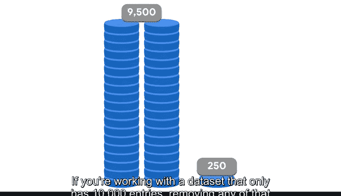

# 谷歌高阶数据分析6：《机器学习的基础知识》the-nuts-and-bolts-of-machine-learning（中英双字） - P23：23_02_09_解决不平衡数据集带来的问题.zh_en - GPT中英字幕课程资源 - BV1GW4y1o794

Hello again。 In this video， we'll continue our exploration of the analyze stage of pace。

 Understanding what your variables are and how they're structured is only part of the process。

 It's also essential to understand the frequency in which the variables exist for classification problems。

 You need to specifically understand the frequency of the response variable。😊，As a data professional。

 you might encounter data sets that are unequal in terms of their response variables。

 One example of unequal data sets is in the context of fraud detection。

 You could have millions of examples of non fraudulent transactions and only a few thousand examples of actual fraudulent transactions。

 How can a model be built to detect fraud with such limited data to train the model。

This issue is known as class imbalance。 A class imbalance is when a data set has a predictor variable that contains more instances of one outcome than another。

The class with more instances is called the majority class。

 While the class with fewer instances is called the minority class。

 It's extremely rare for a data set to have a perfect 50，50 split of the outcomes。

 There is normally some degree of imbalance。 However， this isn't necessarily a problem。

 Belve it or not， A 7030 or a 8020 split can be fine。

 Major issues only arise when the majority class makes up 90% or more of the data set。

 You'll only know if there's an imbalance issue after the model is built。😊。

There are two techniques that allow us to fix any potential issues up sampling and down sampling。

 Both of them involve altering the data in a way that preserves the information contained in the data while removing the imbalance。

Down sampling involves altering the majority class by using less of the original data set to produce a split that's more even。

 The number of entries of the majority class decreases， leading to more of a balance。

You can use different techniques to achieve this， but generally they are all based on this concept。

One technique is to do this randomly by selecting entries to remove， or you can follow a formula。

 For example， you can take the mean of two data points in the majority class。

 remove those data points and add the average data point。

Up sampling is the opposite of down sampling。 Instead of reducing the frequency of the majority class。

 you artificially increase the frequency of the minority class， similar to down sampling。

 There are multiple ways you can achieve this。 The simplest technique is called random overs。

 where random copies of data points in the minority class are copied and added back to the data set。

Or mathematical techniques can be used to generate non identical copies。

 which are then also added to the data set。 So if both up sampling and down sampling achieve the same result。

 you might be wondering which one to use。Most of the time。

 you won't know which one is preferred until you've built the model and observed how it performs。

However， there are some general rules you can follow regarding when to up sample and when to down sample。

Downsampling is normally more effective when working with extremely large dataset sets。

 If you have a dataset set that has 100 million points， but has a class imbalance。

 You don't need all of that data to build a good model。

 You definitely don't need the additional data that would come from up sampling。Alternatively。

 up sampling can be better when working with a small data set。

 If you're working with a data set that only has 10000 entries。

 Re any of that data will more than likely have a negative impact on the model's performance。

 Keep in mind， Class balancing is a fickle process and may require some trial and error。

 Building models with both up sampleled data and down sample data will determine which technique is better in any given situation。

Additionally， you'll have to experiment with what sort of split your rebalancing achieves。

 balancingcing the data so the classes are split 5050 might not always be optimal。 On the other hand。

 turning a 99，1 split into a 7030 split might be fine。

 And that is something to consider as you develop your model。

