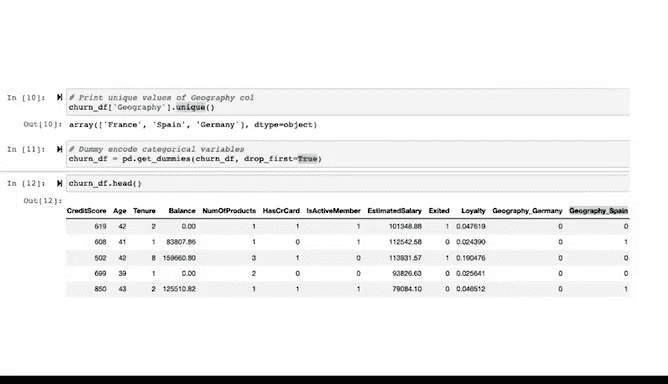

# 谷歌高阶数据分析6：《机器学习的基础知识》the-nuts-and-bolts-of-machine-learning（中英双字） - P24：24_02_11_特征工程与类别平衡.zh_en - GPT中英字幕课程资源 - BV1GW4y1o794

Welcome back In this video， you'll code in Python to wrap up the analyze stage of the pace framework。

In the analyze stage， you gain a deeper understanding of your data。

 This is the stage where you prepare your data so it can be used to train the model。

 Then you'll move on to the construct stage of the pace workflow。

 For the rest of this part of the course， well build models that will predict customer churn at a bank。

Customer churn is the business term that describes how many and at what rate customers stop using a product or service or stop doing business with a company altogether。

The models will be supervised classification models because they'll each predict a categorical target in this case。

 it's a binary one， whether or not each customer churned or stayed。Before we get into the data。

 we need to import the packages that we'll use。All we'll need for this notebook are NI and pandas because we're only preparing the data for modeling。

Now we'll read in the data set from a CSV file to a panda's data frame。

 we'll call the data frame DF original and inspect it using the head function。

The data that we'll be using to solve this problem contains customer data。

 where each entry in the data represents one customer。For each customer。

 there are several features that describe the customer's relationship with the bank and information about the customer's finances Additionally。

 there's metadata for each customer like name， gender， and customer identification number。

The two features that might not be completely intuitive are tenure。

 which represents how many years the customer has used the bank and geography。

 which identifies which country the customer lives in。Additionally。

 we have the feature labeled Exed this indicates whether the customer left the bank。

 a one signifies that they stopped doing business with the bank and a zero indicates that they are still a customer the variable exited will be the response variable or the variable that our model will attempt to predict。

When modeling， the best practice is to perform a rigorous examination of your data before beginning feature engineering and feature selection。

This process is important because not only does it help you understand your data。

 what it's telling you， and what it's not telling you。

 but it can also give you clues about what new features to create。

You've already learned the fundamentals of exploratory data analysis or EDA。

 so this notebook will skip that essential part of the modeling process。

 just remember that a good data science project will always include EDA。

Let's get a quick overview of our data， we'll use the info function to inspect the data frame。

From this table， we can confirm that the data has 14 features and 10，000 observations。

We also know that nine features are integers， two are floats， and three are strings。 Finally。

 we can tell that there are no null values because there are 10。

000 observations and each column has 10，000 non null values。Next。

 we'll prepare this dataset set to be used to train the model。

 The first thing we're going to do is feature selection。 If you recall。

 this is the process of picking out the features that we want the model to use to predict the outcome。

 And we drop any features that aren't useful to the model。 In our bank data。

 noticeice that the first column is called row number。 This just enumerates the rows。

 Since a row number shouldn't have any intrinsic correlation with our response variable。

 we'll remove this feature from our data set。The same is true for customer ID。

 which appears to be a number assigned to the customer for administrative purposes， and surname。

 which is the customer's last name， we'll drop these two。

As you complete feature selection keep the ethical concerns you learned earlier in the course in mind。

 consider the implications of your data and the resultant model For example。

 in this modeling exercise we will not include the gender column this data feature raises a set of complex issues technically culturally and ethically we recognize that the most rigorous approach would be to model both with and without this feature and examine how it influences predictions。

Whatever the approach， it should be driven by an aim for equitable outcomes and for your particular use case。

 we'll remove these columns by calling the drop function on our data frame。

We pass to it a list of names of the columns that we want to remove。

 and we indicate that we're dropping columns not rows by including axis equals 1 we'll assign the results to a new data frame called churnN DF。

The resultant data frame is shown by calling the head method， however。

 there's still more to do before we start training the model。Next。

 let's practice feature extraction this is the process of taking two or more features and using them to create a brand new feature that will make the model more accurate。

Normally， feature extraction is done using statistics to analyze how predictive each variable is and whether the new feature that is extracted is more predictive than the original variables on their own。

 For now， we're going to extract a feature as an example without conducting the analysis we would normally perform if we were trying to build a production ready model。

Let's create a new variable and call itLo。We'll do this by taking the tenure of a customer and dividing it by their age。

The logic behind using tenure and dividing it by the customer's age is that it represents the percentage of a person's life that they've been customers of the bank。

People with greater percentages may be more loyal customers。Now we have a new column calledLoy。

 which we can verify by inspecting the data frame。Let's move on to feature transformation。

There are some features in this dataset set that need to be transformed。 Remember。

 feature transformation is the process of changing how a single feature is represented in the dataset set with the goal of improving the accuracy of the model。

Many classification models require you to convert categorical features to make them numeric。

Our data has one categorical feature called Ge。Let's check how many classes appear in the data for this feature by using the unique function on the series。

There are three unique values， France， Spain and Germany。

Let's encode this data so it can be represented using Boolean features we'll use a pandas function called get dummies to do this。

When we call pd。ge dummies on this feature， it will replace the geography column with three new Boolean columns。

 one for each possible category contained in the column being dummed。

When we specify drop first equals true in the function call。

 it means that instead of replacing geography with three new columns。

 it will instead replace it with two columns。We can do this because no information is lost and the data set is shorter and simpler。

In this case， we end up with two new columns called Geography Germany and Geography Spain。

 we don't need a geography France column， why not， because of a customer's values in geography Germany and geography Spain are both zero。

 we'll know they're from France。After feature selection， extraction， and transformation。

 the next step is modeling。

We'll be using this data set for most of the modeling you'll do in the remainder of this part of the course。

 and you now have a solid foundation for the construct and execute stages of pace。

