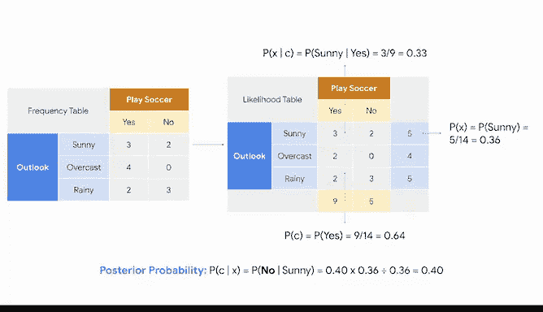

# 谷歌高阶数据分析6：《机器学习的基础知识》the-nuts-and-bolts-of-machine-learning（中英双字） - P25：25_02_01_朴素贝叶斯入门.zh_en - GPT中英字幕课程资源 - BV1GW4y1o794

Hello， again。 You're now about halfway through the pace workflow。 During the planning stage。

 you developed a better understanding of the business need and the data available。

 And in the analyzed stage， you investigated the data using exploratory data analysis practices。

 You applied feature engineering techniques to select。

 transform and extract data into a format that was suitable for training。

 This video continues on to the construct stage where you'll bring the model to life。

 You'll do this by building a model called naive bayase。

 naive Bayase is a supervised classification technique based on Bay theorem with an assumption of independence among predictors。

 The effect of the value of a predictor variable on a given class is not affected by the values of other predictors。

😊，Let's break it down。 Bay theorem gives us a method of calculating the posterior probability。

 which is the likelihood of an event occurring after taking into consideration new information。

 In other words， when you calculate the probability of something happening。

 you take relevant observations into account。It can be represented with this equation。

 which calculates the posterior probability of C given X probabilityability of x given C is the probability of the predictor。

 given the class， which is multiplied by P of C， the prior probability of the class。

 The product of these two terms is then divided by P of X。

 which is the prior probability of the predictor。 The posterior probability equation can be rewritten to reveal what's going on behind the variable。

 The probability of a class given the first predictor variable。

 P of X 1 given C is multiplied by the probability of a class。 given the second variable。

 P of X2 given C， and so on for all predictor variables used in the model。This is complex。

 so let's return to the weather based example that we discussed in an earlier video and apply naive Bayase to gain a better understanding。

The weather data set will help you build a model to decide whether to go outside and play soccer。

This data set has five columns。 The first four are the predictor variables。

 and the final column is the label of the data set。 It shows whether we should play soccer。

 The outlook variable identifies if it is rainy， cloudy or sunny。

 The humidity variable indicates the relative humidity。 and， of course。

 the windy variable determines if there's wind。Start with the outlook variable。

 Calculate the posterior probability of one of the features in the data set to do this。

 construct a frequency table for each attribute against the target by tallying the number of times soccer is and isn't played for a given attribute。

Then transform the frequency tables into likelihood tables by calculating the number of times soccer is and isn't played for each attribute。

Use this information to find the probability of the predictor given the class， P of x given C。

The probability of the class， P of C and the probability of the predictor， P of X。 In other words。

 everything needed to calculate the posterior probability。 As a reminder。

 you may pause and review the video if needed。The process of finding the posterior probability needs to be done for every possible class that is potentially being predicted。

 In this case， there are only two outcomes。 play or don't play。Once these values are found。

 the prediction is made based on the class with the highest posterior probability。

When you repeat the process for the second class， don't play。

 you're only required to modify the calculations after finding the likelihood table。

Observe that the posterior probability of playing while it is sunny is higher than the posterior probability of not playing。

 So if it's sunny outside， a naive ba model would predict that the conditions are right to play soccer。

Later， you'll explore how multiple predictor variables can be used to make a prediction。

 All the same concepts will apply。 No matter the number of variables that are used。

 Naive Bayes calculates posterior probabilities and makes predictions based on which outcome has the highest probability。

You're doing great work， keep up the momentum and I'll be with you again soon。

