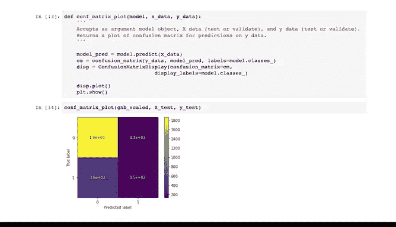

# 谷歌高阶数据分析6：《机器学习的基础知识》the-nuts-and-bolts-of-machine-learning（中英双字） - P26：26_02_03_用Python构建朴素贝叶斯模型.zh_en - GPT中英字幕课程资源 - BV1GW4y1o794

Now that we've discussed how naive Bayase works， it's time to implement it using Python。

 We're going to continue our work with the Bank churn data frame that we prepared in the feature engineering notebook。

Remember， we dropped the row number， customer ID， surname， and gender columns。

 dummy encoded the geography column to convert from categorical to Boolean and engineered a new feature calledLoy by dividing each customer's tenure by their age。

Recall that the predictor variables of this data are of different types， for example。

 balance and estimated salary are continuous while geography is categorical。Also。

 remember that SKLn has a few different implementations of the naive B algorithm and each assumes that all of your predictor variables are of a single type。

As a data professional， one of the first things you'll learn on the job is that real world data is never perfect。

 sometimes the data violates the assumptions of your model in practice you'll have to do the best you can with what you have。

For this lesson， we're going to use the Gaussian NB classifier。

 this implementation assumes that all of your variables are continuous and that they have a Gaussian or normal distribution。

Our data doesn't perfectly adhere to these assumptions。

 but a Gaussian model may still give us usable results， even with imperfect data， let's get started。

As always， the first thing to do is import any packages and libraries that you'll need we'll begin by importing NumpI。

 pandas and Matpllootlibb will also import Tra test split to help us split our data into training and test sets。

The model we'll be using is called Gaussian NB， which we import from P SyKt Learn's Naive Bays module。

Next， we'll import functions that we'll use to calculate our model's accuracy， precision， recall。

 and F1 scores。Finally， we'll import Con matrix and Con matrix display。

 which will help us calculate and plot a confusion matrix of our model's results。

Let's read in the data frame and call it churn DF。Before we begin modeling。

 let's do a couple more things first we'll check the class balance of the exited column。

 which is our target variable we can do this by calling value counts on the pandas series。

The class is split roughly 8020， in other words， about 20% of the people in this data churned。

This is an unbalanced data set， but it's not extreme。

 so we'll proceed without doing any class rebalancing of our target variable。Secondly。

 naive Bayase models operate best when the predictor variables are conditionally independent from each other。

When we prepared our data， we engineered a feature called loyalty by dividing tenure by age。

 because this new feature is just the quotient of two existing variables。

 it's no longer conditionally independent， so we're going to drop tenure and age。

This step may or may not be beneficial， but we'll do it to help adhere to the assumptions of our model。

We've prepared our data and we're ready to model now we need to split the data first into features and target variable and then into training data and test data。

Let's assign our predictive features to a variable called X and the exited column our target to a variable called Y。

 then we can split into training and test data， we do this using the train test split function。

 we'll put 25% of the data into our test set and use the remaining 75% to train the model。

Notice that we include the argument stratify equals y if our master data has a class split of 8020。

 stratifying ensures that this proportion is maintained in both the training and test data。

Equals y tells the function that it should use the class ratio found in the Y variable。

 which is our target。The less data you have overall and the greater your class imbalance。

 the more important it is to stratify when you split the data。If we didn't stratify it。

 then the function would split the data randomly， and we could get an unlucky split that doesn't get any of the minority class in the test data。

In that case， we wouldn't be able to effectively evaluate our model， worst of all。

 we might not even realize what went wrong without doing some detective work。Finally。

 we set a random seed so we and others can reproduce our work now it's time to build the model。

Just as with linear and logistic regression， our modeling process will begin with fitting our model to the training data and then using the model to make predictions on the test data。

First， we'll instantiate the Gaussian NB model， assigning it to a variable called GNB。

Then we'll fit it to the X and Y training data。Lastly。

 we'll use the predictt method to use the model to make predictions on the X test data。

 assigning the results to a variable called Y preS。

Now we can check how our model performs using the evaluation metrics we imported for each one。

 we pass to it first the actual Y test data and then the predictions。嗯。😊，This isn't very good。

 our precision， recall and F1 scores are all zero， what's going on？Well。

 let's consider our precision formula， there are two ways for the model to have a precision of zero。

 the first is if the numerator is zero， which would mean that our model didn't predict any true positives。

The second is if the denominator is also zero， which would mean that our model didn't predict any positives at all。

Dividing by zero results in an undefined value， buts kitt learn will return a value of0 in this case。

Depending on your modeling environment， you may get a warning that tells you there's a denominator of zero。

We don't have a warning， so let's check which situation is occurring here。To do this。

 we'll call NumpI's unique function on the predictions， okay？

The model predicted zero or not churned for every sample in the test data。

 both the numerator and the denominator are zero。Consider why this might be。

 perhaps we did something wrong in our modeling process。

 or maybe using Gaussian NB on predictor variables of different types and distributions just doesn't make a good model。

Maybe there were problems with the data。Before we give up。

 maybe the data can give us some insight into what might be happening or what further steps we can take let's useDescribe to inspect the X data。

Something that stands out is that the loyalty variable we created is on a vastly different scale than some of the other variables we have。

 such as balance or estimated salary。The maximum value of loyalty is 0。56。

 while the maximum value for balance is over 250，000， almost six orders of magnitude greater。

One thing that you can try when modeling is scaling your predictor variables。

 some models require you to scale the data in order for them to operate as expected。

 while others don't。Nive Bayase does not require data scaling， however。

 sometimes packages and libraries need to make assumptions and approximations in their calculations。

We're already breaking some of these assumptions by using the Gaussian NB classifier on this data set。

 and it may not be helping that some of our predictor variables are on very different scales。

In general， scaling might not improve the model， but it probably won't make it worse， let's try it。

We'll use a function called MinM Scalar， which we' import from the SKLear preprocess module。

Min Macac Scalar normalizes each column， so every value falls in the range of0 to1。

The column's maximum value would scale to1， and its minimum value would scale to zero。

 everything else would fall somewhere in between。This is the formula。To use a Scalar。

 you must fit it to the training data and transform both the training data and the test data using that same scalar。

Let's apply this and retrain the model。First， import the Scalar。

Then we'll instantiate it and assign it to a variable called Scalar。

Now we fit the scalar by passing our X train data to it。Next。

 we use the transform method to scale the X training data， finally， we transform the X test data。

Now we'll repeat the steps to fit a model， only this time we'll fit it to our new scaled data。

When we calculate the performance metrics for this model， we don't get an error。

 the model isn't perfect， but at least it's now predicting customers who churn。

Let's examine more closely how our model classified the test data。

 we'll do this with a confusion matrix。Remember that a confusion matrix is a graphic that shows you your model's true and false positives and true and false negatives。

We can plot this using the confusion matrix display and confusion matrix functions that we imported。

Here's a helper function that will allow us to plot a confusion matrix for our model。

All of our model metrics can be derived from the confusion matrix。

 and each metric tells its own part of the story。 What stands out most in the confusion matrix is that the model misses a lot of customers who will churn。

 In other words， there are a lot of false negatives。

 355 to be exact This is why our recall score is only 0。303。

Coming up， you'll investigate the various model evaluation metrics and when to use them。

 You'll explore the use of several metrics to evaluate model performance。

 Then you will determine which of the models best satisfies the business requirements for the data project。

 Meet you there。