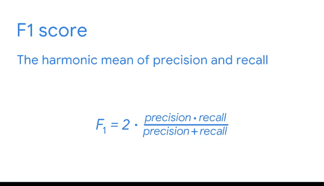

# 谷歌高阶数据分析6：《机器学习的基础知识》the-nuts-and-bolts-of-machine-learning（中英双字） - P27：27_02_04_分类模型的关键评估指标.zh_en - GPT中英字幕课程资源 - BV1GW4y1o794

Wow， you've reached the last stage of the pace workflow。 Ex。 This is where model analysis happens。

 and it's finally production ready。 You've already learned a lot about model metrics。

 the options available to you。 and what they can demonstrate to a data professional about the model that has been built。

 And you've built supervised learning models， including a categorical model in the form of logistic regression。

😊，The metrics you used to evaluate those models will also make it possible to evaluate a naive Bayes model。

As a review， accuracy reflects the number of correct predictions divided by the total number of predictions。

 However， accuracy doesn't always tell the full story。

 Some data sets will feature a strong class imbalance。

 which occurs when the majority of items belong to only one class。

 Then the dataset set is considered imbalanced。Here's an example using a binary classification problem。

An IT professional wants to use a model to detect malware in the computers at their company。

Perhaps there are 5，000 instances in their dataset set。

 but only 500 positive instances where malware was actually present in a computer。

This person would have an imbalanced data set as the chances of finding malware among all the checks that happen is actually comparatively low。

This is where the precision and recall metrics can help。

 Precision measures what proportion of positive predictions were correct。In other words。

 if the model predicted that malware was going to be present。

 how many times was it actually on a computer， Precision is calculated by dividing the number of true positives by the sum of the true and false positives。

And the recall metric， on the other hand， finds the proportion of actual positives that were identified correctly。

 In the context of our example， recall indicates how many would be malware threats were classified。

 Reca is calculated by dividing the number of true positives by the sum of the true positives and false negatives。

 F1 score combines both precision and recall in one metric。😊。

Accuracy， precision， recall and F1 score are top metrics in classification techniques。

 More specifically， precisionion， recall and F1 score are especially useful for measuring unbalanced classes。

😊，In any case， data professionals use all four metrics to evaluate categorical。

 supervised learning models。 As you've begun to discover， each model performs differently。

 and some algorithms work better than others。 When building any model intended for production。

 it's essential to improve the results。 you might change specific parameters to discover how the performance improves。

So you should always keep in mind that model building is an inherently iterative process。

 The first model that you produce will almost never be the one that gets deployed。

 The iterative process provides the information needed to get the model working optimally after tweaking the parameters or changing how features are engineered in each model。

 The performance metrics provide a basis for comparing the models to each other and against themselves。

Coming up， we'll find out what these metrics reveal about our model。

 Use them to evaluate other models we've built and examine how to improve model performance。

 Contin improvement is a key part of being a data professional。

 So these exercises are preparing you to keep advancing all kinds of data processes。

