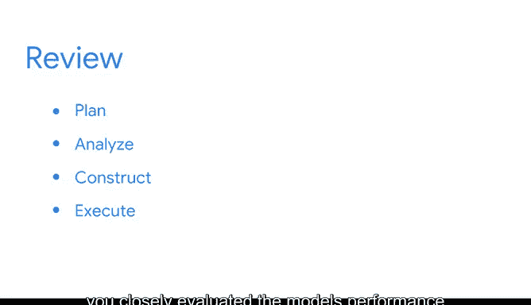

# 谷歌高阶数据分析6：《机器学习的基础知识》the-nuts-and-bolts-of-machine-learning（中英双字） - P28：28_02_01_总结_2.zh_en - GPT中英字幕课程资源 - BV1GW4y1o794

Developing a machine learning model is a complex process。

 but having a solid framework to rely on helps set you up for success， no matter the business need。

In this part of the course， the PAC workflow provided support to help you navigate the different stages of addressing an example business scenario。

During the plan stage， you assessed the business need to determine what type of model is best suited for predicting bank customer churn This decision was based on the available data。

Next， in the analyzed stage， you examined the data using E DA practices and feature engineering techniques。

 This process revealed more details about the data to help inform your plans for building the model。

From there， you went on to construct the first iteration of your naive Bayes model。

 You then tested the model with preliminary evaluation metrics to determine its performance against the test data。

 And finally， in the execute stage， you closely evaluated the model's performance and considered how it could be improved。

And that is the pace workflow for machine learning models。

 Having this process in your tool belt will allow you to solve many business problems。

 While the models may very well get more complex as you continue your journey。

 Sticking within the framework will help you achieve the results you need。😊。

