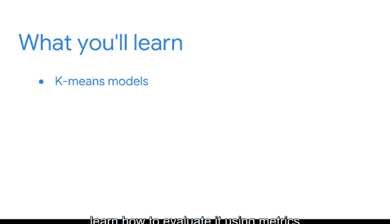

# 谷歌高阶数据分析6：《机器学习的基础知识》the-nuts-and-bolts-of-machine-learning（中英双字） - P29：29_03_01_欢迎来到模块3.zh_en - GPT中英字幕课程资源 - BV1GW4y1o794

You've come a long way on your journey into the world of data。

 and you've been building a strong foundation for data modeling。So far。

 you've learned about linear regression， logistic regression and naive Bay models。

 all supervised learning techniques that make predictions on labeled data。

 most machine learning applications today are based on supervised learning。

 But when we consider all the available data in the world。

 the vast majority of it is unlabeled photographgraphs， voice recordings， videos， social media posts。

 these are all examples of unlabeled data。You may be familiar with this concept in the context of data analytics。

 If you earned your Google Data Analytics career certificate。

 you learned that any data that's not organized in an easily identifiable manner is known as unstructured。

In this program will sometimes refer to it as unlabeled。 But the meaning is the same。

 So how do we make sense of all that unlabeled data。

 We use unsupervised learning techniques when our data is unlabeled These methods make it possible for data professionals to learn about the data's underlying structure。

 and find out how different features relate to each other。 Earl in the course。

 You explored one very common type of unsupervised learning recommendations systems。

 You learn that they' are a subclass of machine learning algorithms which offer relevant suggestions to users such as new songs for your playlist or a new code for winter。

 Now， you'll get to know many other exciting methodologies and applications of unsupervised learning。

 In this section of the course， you'll first learn about K means。

 an unsupervised modeling techniques。 you'll investigate how it clusters data based on each observation similarity to others in the data。

 You'll also build a K means model and learn how to evaluate it using metrics called inertia and。😊。

Lette score。I'm thrilled to have you with me as we explore unsupervised learning。

 There's so much great potential for future development。

 We've only just begun tapping into the vast amount of unstructured data in the world。

 Let's start modeling。😊。