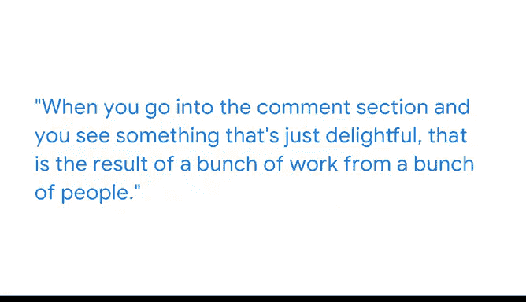

# 谷歌高阶数据分析6：《机器学习的基础知识》the-nuts-and-bolts-of-machine-learning（中英双字） - P2：02_01_03_Susheela-用数据愉悦人心.zh_en - GPT中英字幕课程资源 - BV1GW4y1o794

I'm Sila。 I'm a senior data scientist here at Google。

 I work with teams at YouTube to answer questions they have about their product with data。

 A typical day for me can look very different depending on which day of the week it is。

 I like to guard some of my days of the week where I have very few meetings。

 and that's time for me to have really deep work time， really focused time。 usually during that time。

 I will be either working on current analyses， planning， future analyses， writing up summary results。

 preparing presentations， any number of these things。

 things where I really need to focus and work on a one thing， uninterrupted for long chunks of time。

😊，On the other days， I typically have a lot of meetings with software engineering partners。

 product managers， anybody that really can help me give context to my problems。

 My favorite thing about being a data scientist is really getting to have an impact on people's lives。

 especially with a product like YouTube。 In my role。

 I've done a lot of measuring of comments quality， And for this。

 we have a lot of different kinds of data， We have logging data where we can see things like how many comments did you read。

 How many did you write， How many minutes of a video did you watch， all the way to survey data。

 where we'll ask users， how did you， How did you find this comment， Was it satisfying。

 Did you enjoy it， These kinds of categorical responses， are super helpful。

 that we then turn into binary things to classify comments as good or bad。😊。

When you go into the comment section and you see something that's just delightful。

 that is the result of a bunch of work from a bunch of people。

And that algorithm is built on this data。 When we make improvements to the comment section。

 it has an actual effect on people's lives。 Their experience with the product gets better。

 And YouTube is a product that touches so many people。

 It's an amazing way to be able to kind of feel like you're part of somebody's life。

 Data science and breaking into the data science field can be very daunting。

 It can be a very intimidating field where it feels like everyone has these fancy models and these big presentations And you just don't have those things。

 You don't know how to do them yet。😊，But keep at it。 You will。 You will learn how to do these things。

 Everybody had to start somewhere interviewing for data science roles is maybe the most unprepared I had ever felt in my life。

 I did not spend my whole life preparing for this exact moment。

 but I got through it because I just kept chipping away at it。

