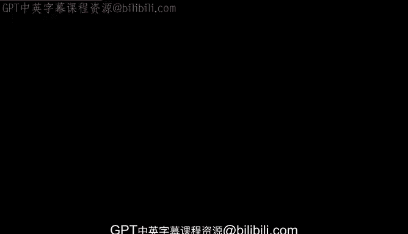
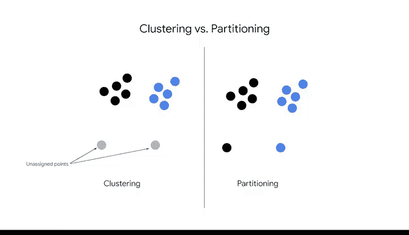

# 谷歌高阶数据分析6：《机器学习的基础知识》the-nuts-and-bolts-of-machine-learning（中英双字） - P30：30_03_02_K均值聚类入门.zh_en - GPT中英字幕课程资源 - BV1GW4y1o794

In this video， we'll introduce you to the K means algorithm。

 K means is an unsupervised partitioning algorithm。

 It's used to organize unlabeled data into groups or clusters。😊。

It does this by creating a logical scheme to make sense of the data with K means each cluster is defined by a central point or a centroid。

 Its position represents the center of the cluster， also known as the mathematical mean。

 hence the name K means。There are four steps to building a K means model。 Let's examine them。

 one at a time。In step 1， you choose the number of centroids and place them in the data space。

 K represents the number of centroids in your model， which is how many clusters you'll have。

 This is a decision that you make。 Sometimes， you'll have an idea about the number of clusters necessary for a project。

 For example， if your company manufactures  five different products。

 you might want to set your K value to 5。 Other times。

 you won't know how many clusters your data should be split into。

 So try different values for K and determine what provides the best results。Here。

 it's apparent that our data is grouped into two clusters。

 one on top and the other on bottom At step 1 well randomly initiate two centroids represented by the blue and red X's。

Step 2 is to assign each data point to its nearest centroid。

 The nearest centroid is the one that's closest in space。 In this example。

 the top two observations are assigned to the blue centroid。

 and the bottom two observations are assigned to the red centroid as a quick refresher in this context。

 and observation is simply any data point being observed。

 Step 3 is to recalculate the centroid of each cluster。 Again。

 the centroids location is calculated by taking the mean of all of the points in its cluster。

Note that the centrics move to the midpoint of their clusters。

 This will happen each iteration until the algorithm reaches convergence。

This is the stable point found at the end of a sequence of solutions。

 Step 4 is to repeat steps 2 and 3， until the algorithm converges。In this case。

 we have very little data， So the model is simple and has already converged。

 If you had a lot more data， the centroids would get increasingly closer to their related clusters。

You also might find that the cluster assignment of each data point changes as the cented locations move within each iteration。

Something to be mindful of is that it's important to run the model with different starting positions for the centroids。

 This helps avoid poor clustering caused by local minima。 In other words。

 not having an appropriate distance between clusters。 Let's explore this concept， using our example。

What if this had been the initial positions of our centroids， Notice what happens。In step 2。

 we assign the points to their nearest centroid with these particular starting positions。

 the two observations on the left are assigned to the red cluster。

 and the two observations on the right are assigned to the blue cluster。For step 3。

 we recalculate the position of each cluster's centroid。 The model has converged。

 but the clusters aren't what we'd expect。 We know that the most intuitive clustering would be for the top two observations to be in one cluster and the bottom2 in another。

 But that's not what happened。 And further iterations will not change this。

This is why it's important to run the model with different centate initializations and to avoid poor clustering due to the model converging in local minima。

 Note that this clustering isn't wrong。 It's still a valid resolution of the model。

 It just doesn't make much sense， in this context。After all。

 the goal is to find a clustering scheme that makes sense of your data。Finally。

 note that even though K means is a partitioning algorithm。

 data professionals typically talk about it as a clustering algorithm。

 The difference is that outlying points in clustering algorithms can exist outside of the clusters。

 However， for partitioning algorithms， all points must be assigned to a cluster。 In other words。

 K means does not allow unassigned outliers。 So to recap。

 K means is an unsupervised learning technique that groups unlabeled data into K clusters based on similarity。

 The clustering process has four steps that repeat until the model converges。😊。

The value for K is a decision that the modeler makes。 And finally。

 it's important to build multiple models to avoid poor clustering。Later in this section。

 you'll learn how to determine the best value for K。

 You'll also discover some of the limitations of K means models， Lots more coming up。

