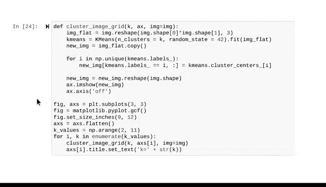

# 谷歌高阶数据分析6：《机器学习的基础知识》the-nuts-and-bolts-of-machine-learning（中英双字） - P31：31_03_04_使用Python进行颜色压缩的K均值聚类.zh_en - GPT中英字幕课程资源 - BV1GW4y1o794

At this point you're familiar with the basic intuition behind the K means algorithm in this video we're going to demonstrate how to apply your knowledge of k means to an actual example。

 we'll use the K means algorithm to compress colors in a photographic image。

This demonstration is intended to lead you through an application of the K means theory to give you a deeper understanding of how it works。

 So for this video， focus less on the mechanics of the code itself and more on the results。

 Let's get started。We're going to use a photograph of some twolip as our data。

 which we'll read in as an array using Matpllootlib's I am read function and display using its IM show function。

 This is the image that we're going to manipulate using K means。

When we check the shape of the image in pixels， we're told that it's 320 by 240 by3。

 We can interpret these numbers as pixel information。 Each dot on the screen is a pixel。

 This photograph has 320 vertical pixels and 240 horizontal pixels。 But what is the dimension of3。

 This dimension refers to the values that encode the color of each pixel。

 Each pixel has three parameters， red or R green or G and blue or B， together。

 these values are known as RGB values。 The value for each color， R G and B can range from 0 to 255。

 This means that there are 256 cubed or more than 16 million different possible combinations of RGB。

 Each resulting in a unique color。 to prepare this data for modeling well reshape it into an array where each row represents a single pixel。

RGB color values。Now we have an array that is 76800 by three。

 Each row is a single pixel's color values。Let's create a pandas data frame to help us understand and visualize this data。

 Each row of the data frame represents a single pixel， and the three columns are its R。

 G and B values。 because we have only three columns。

 We can visualize this data in three dimensional space。

 This graph plots each of the photographs pixels in a 3D coordinate space。

Each axis ranges from 0 to 255， just like each value in RGB。

 and each dot in the graph is the color specified by its RGB values。

 just like in the original photograph。The more intense the color。

 the more dots are concentrated in that area。 The most represented colors here are the most abundant colors in the photograph。

 mostly red， screens and yellows。We can examine this graph from different angles and even zoom in and out。

We can also train a K means model on this data。 The algorithm would create K clusters by minimizing the squared distances from each point to its nearest centroid。

Here's an experiment。What do you expect to happen if we built a k means model with just a single centroid。

 In other words， with K equal to1， let's find out。We'll first instantiate the model As a refresher。

 instantiation involves creating a copy of the class， which inherits all class variables and methods。

 So let's set the number of clusters to one and fit it to our data。 Now。

 we're going to copy the original image。 Re each of its rows with the values of its closest cluster center and reshape the image so we can display it。

😊，The image we get back doesn't resemble tulips at all。 So what happened， Well。

 let's run through the Ka mean steps。 First， the algorithm randomly placed a centroid in the 255 by 255 by 255 color space。

Then it assign each point to its nearest centroid。Because there was only one centroid。

 all points were assigned to it and therefore to the same cluster。Next。

 the algorithm updated the centroids location to the mean location of all of its points。 Again。

 there's only a single centroid， So it updated to the mean location of every point in the image。

 Usually， these steps would repeat until the model converges。 But in this case。

 it took only one iteration。 We updated each pixels RGB values to be the same as those of our centroid。

 The result is the image of our tulips where every pixel is replaced with the average color。

 We can verify this for ourselves by manually calculating the average for each column in the array。

 This will return the mean R value G value and B value。

 Let's compare this to what the K means model calculated as the final location of its one centroid。

 We'll do this by using the cluster centers attribute of the fit K means model object。

 They're the same。 Now， let's return to the 3D rendering of our color space。

 Only this time we'll add the centroid。😊，The centroid is a large circle in the middle of the color space。

 noticeice that this is the center of gravity， so to speak， of all the points in the graph。Okay。

 now let's refit another K means model to the data only this time using K equals 3。

Take a moment now to consider what you might expect to result from this。

Go through the steps of what the model is doing， like we did above。What colors are you likely to see。

 So we refit the model， setting our number of clusters to 3， and we get three centroid locations。

 which are the RGB values we can use to display the colors of each centroid。

 We'll use a helper function to display our color swatches。 And there they are。😊。

You might have hypothesized that there'd be similar colors as a result of the three cluster models。

 And that's correct。 The photo's dominant colors of red， green and yellow are present here。Again。

 we can replace each pixel in the original image with the RGB values of the centroid to which it was assigned by the new K means model。

 This is a function that will display the photo for any value of K that we choose。

 We'll call this function with three as its argument。 We now have a photo with just three colors。

 The same three colors from the swatches above。 Each colorss RGB values correspond to the values of the location of its nearest centroid。

 We can return once more to our 3D coordinate space。

 This time will recol each dot to correspond with the color of its centroid。

 This will allow us to see how the K means algorithm clustered our data spatially。 Check it out。😊。

Each pixel is now colored according to the RGB value of its centroid。

 and the clusters are at the vertices of the space。

This whole process can be applied for any value of k。

 Here's the output of each photo for K equals 2 through 10。

 Notice that it becomes increasingly difficult to see the difference between the images each time a color is added。

 This is a visual example of something that happens with all clustering models。

 Even if the data is not an image that you can see。

 As you group the data into more and more clusters。

 additional clusters beyond a certain point contribute less and less to your understanding of your data。

 This demonstration has deepened your understanding of how the K means algorithm works。

Soon， we'll explore methods for numerically determining which K value is best for particular data。

 As always， feel free to explore the notebook more on your own to keep building your skill set。

