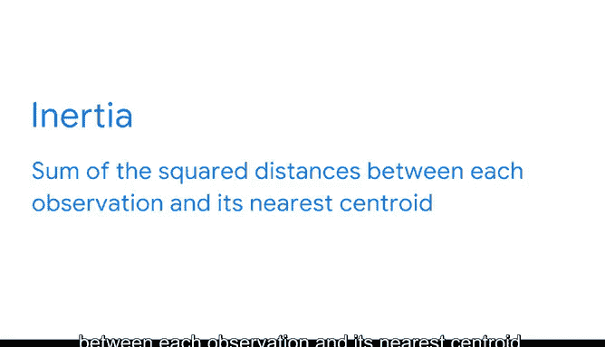

# 谷歌高阶数据分析6：《机器学习的基础知识》the-nuts-and-bolts-of-machine-learning（中英双字） - P32：32_03_01_K均值聚类的关键表示指标.zh_en - GPT中英字幕课程资源 - BV1GW4y1o794

You now have some familiarity with the intuition behind the K means methodology。

 In some of the examples we presented。 we plotted points in two dimensional space。 In those cases。

 it was clear if the model was correctly assigning points to clusters。

 We also studied an example where we were able to visualize the data in three dimensions。

 Unfortunately， most cases， data professionals encounter on the job are not so easy。

 Your data will have many more than three dimensions。

 So you will not be able to visualize how each observation relates to those around it。

You might not even know how many clusters there should be。

So how do you decide the value for k and once you do。

 how do you know if your model is working as intended？In linear and logistic regression。

 you used metrics such as R squared mean squared error area under the R O C curve。

 precision and recall to evaluate the effectiveness of your model。 But in unsupervised learning。

 you don't have any labeled data to compare your model against The metrics aren't applicable。

 In fact， your model isn't predicting anything。 Instead。

 its grouping observations based on their similarities。

 it's up to you to investigate and understand the different clusters。Remember。

 if you have some domain knowledge or the problem you're trying to solve has its own constraints。

 Use these things to your advantage。 For example， maybe you're investigating customer segmentation for a service that offers four different subscription levels。

 Then you'd probably want to use4 as your value for K。

 But if you have no way of knowing an advance what value to use for K， don't worry。

 there are other ways to figure it out。 before we get started with valuation metrics。

 consider what makes for a good clustering model。 Basically， you want clearly identifiable clusters。

 This means that within each cluster or intra cluster， the points are close to each other。

 It also means that between the clusters themselves or intra cluster， you want lots of empty space。

One way to evaluate the intra cluster space in a K means model is to identify its inertia。

 This is a different concept from inertia， as it's defined in physics Here。

 inertia is defined as the sum of the squared distances between each observation and its nearest centroid。

Essentially， this is a measurement of how closely related observations are to other observations within the same cluster。

That information is then aggregated across all the clusters to produce a single score for the particular metric being measured。

Another important metric for evaluating your k means model is the silhouette score。

 This is a more precise evaluation metric than inertia because it also takes into account the separation between clusters。

Silhouette score is defined as the mean of the silhouette coefficients of all the observations in the model。

 We'll cover this in more depth later。 For now， just know that the silhouette score helps evaluate your model providesdes insight as to what the optimal value for K should be and uses both intra cluster and intra cluster of measurements in its calculation。

😊，Nice work。 You now have a better understanding of what makes a good clustering model。

 You also understand more about some of the metrics to determine your model's effectiveness。

 Coming up， we'll further explore these metrics and learn how data professionals put them to use on the job。

😊。