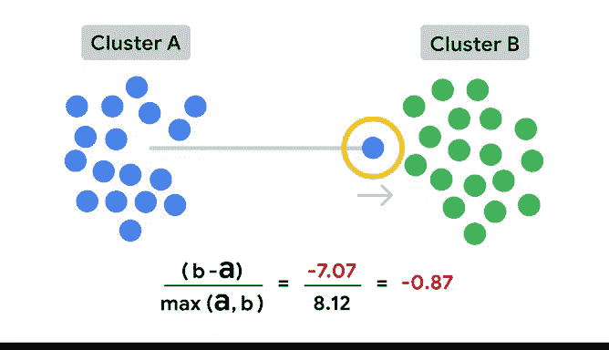

# 谷歌高阶数据分析6：《机器学习的基础知识》the-nuts-and-bolts-of-machine-learning（中英双字） - P33：33_03_02_惯性度量和轮廓系数指标.zh_en - GPT中英字幕课程资源 - BV1GW4y1o794

Previously， you were introduced to inertia and silhouette scores as metrics to evaluate K means models。

 These are indispensable tools for data professionals who work with K means models and any other model in the clustering family。

 Now， let's expand on these concepts。😊，Consider again， what makes a good clustering model。 Idely。

 you'd have tight clusters of closely related observations。

 and each cluster is well separated from other clusters。

 Remember that inertia is the sum of the square distances between each observation and its closest centroid。

 It's a measurement of intra cluster distance。 So it gauges how closely related。

 Each observation is to the other observation in its own cluster。

 inertia can be represented by this formula where n is the total number of observations in the data and C sub K is the centroid of the cluster that the observation X sub I is in。

😊，The more compact the clusters， the lower the inertia。

 because there's less distance between each observation and its nearest centroid。 Therefore。

 it's important for inertia to be as close to 0 as possible。Can inertia ever be zero， Well。

 it's possible， but this scenario wouldn't offer any new insight into the data。Here's why。

In one case， if all observations were identical， this would mean all data points are in the same location。

 then inertia equals 0 for all values of k。And the second case is when the number of clusters is equal to the number of observations。

 If each observation is in its own cluster， then its centroid is itself。

Inertia is a great metric because it helps us to decide on the optimal K value。

 We do this by using the elbow method。😊，In the elbow method。

 we first build models with different values of k。 Then we plot the inertia for each K value。

Here's an example。Notice that the greater the value is for K， the lower the inertia。

 So should you always select high K values well。No， a low inertia is great。

 but if it results in meaningless or inexplicable clusters， it doesn't help you at all。

A good way of choosing an optimal K value is to find the elbow of the curve。

This is the value of K at which the decrease in inertia starts to level off。 In this example。

 that occurs when we use three clusters。 Sometimes it might be difficult to choose between two consecutive values of K。

 In that case， it's up to you to determine which is best for your particular project。

The second important metric for evaluating your K means model is the silhouette score。

 This is a more precise evaluation metric than inertia。

 because it takes into account the separation between the clusters。

 silhouette score is defined as the mean of the silhouette coefficients of all the observations in the model。

😊，Each observation has its own silhouette coefficient。

 which is calculated as B minus a over whichever value is greater， A or B。

 where a is the mean distance from that observation to all other observation in the same cluster。

 and B is the mean distance from that observation to each observation in the next closest cluster。

The silhouette coefficient can be anywhere between negative  one and one。Consider this schematic。

 If an observation has a silhouette coefficient close to one。

 It means that it's both nicely within its own cluster and well separated from other clusters。

 A value of 0 indicates that the observation is on the boundary between clusters。

If your observation has a silhouette coefficient close to negative one。

 it may be in the wrong cluster。

So， as you've just experienced when using silhouette score to help determine how many clusters your model should have。

 you'll generally want to opt for the K value that maximizes your silhouette score。

 inertia and silhouette score are important metrics to help you determine the most appropriate number of clusters for your K means model。

 Now that you're familiar with how they're derived。

 you'll be well prepared to continue working with them。😊。

