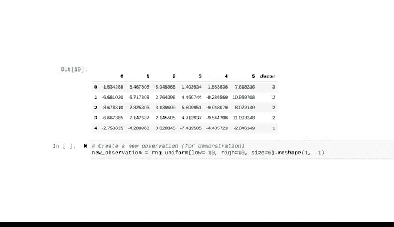

# 谷歌高阶数据分析6：《机器学习的基础知识》the-nuts-and-bolts-of-machine-learning（中英双字） - P34：34_03_04_用Python应用惯性和轮廓分数.zh_en - GPT中英字幕课程资源 - BV1GW4y1o794

Previously， you learned about inertia and silhouette scores。

 you understand that there are metrics used to help decide an effective value for K in a K means model。

And because K meansan is an unsupervised learning model。

 it's used to find structure and relationships within data， but there are no right answers。Therefore。

 data professionals who use these models have to rely on these metrics to help them determine whether their model is identifying characteristics of their data that are useful for their needs。

 In this video， we are going to build a K means model and evaluate it using inertia and silhouette score。

 We'll go over which packages to import how to scale data， instantiating and fitting the model。

 and of course， using the labels and inertia attributes and silhouette score function to determine a final value for K。

Once again， we'll return to Jupiter notebooks as the platform where we'll build our models。

In a new notebook， the first step， as always， is to begin with import statements。

 this will create the computing environment with the necessary packages and tools for your project。

In this case， we'll import nuumpy and pandas as our operational packages。

We'll also import the following task specific items from Psit Learn， K means。

 silhouette score and Standard Scalar。Note the syntax as each item is imported from a different package。

 K means comes from SK learn dot cluster， silhouette score comes from S K learn dot metrics。

 and standard Scalar comes from S K learn dot pre processinging。

 The function make blobs is something we'll use just for this demonstration to help us create synthetic data。

 We'll use seaborn for graphing。In practice， you'd have a real data set and you'd read in this data and perform EDA。

 data cleaning， and other manipulations to prepare it for modeling。

For simplicity and to help us focus on modeling and analysis。

 we are going to use synthetic data for this demonstration。

 We'll start by creating a random number generator。

 This is to help create reproducible synthetic data。 We'll use it to generate clustered data。

 For now， we won't know how many clusters there are。

 by calling the random number generator and assigning the result to a variable。

 We can avoid viewing the true number of clusters our data has。

 This will let us use inertia and silhouette coefficients to determine it。

This next step uses make blobs and our random number generator to create data that has an unknown number of clusters。

 at least to us。These steps return a Ny array， but it's usually helpful to view your data as a panda's data frame。

 This is often how your data will be organized when modeling on the job。

 So we'll convert our data to a panda's data frame。In the six columns。

 we find that our data has six features。 This is too many dimensions for us to visualize in 2D or 3D space。

 We can't observe how many clusters there are， so we'll need to use our detective skills to figure it out。

 because K means uses distance between observations as its measure of similarity。

 It's important to scale our numerical data before modeling if it's not already scaled。For this。

 we'll use PsKit Learns standard Scalar Standard Scalar scales each point x sub I by subtracting the mean for that feature and dividing by the feature's standard deviation。

This ensures that all the variables have a mean of zero and a variance standard deviation of1。

There are a number of scaling techniques available in P SKtLn's preproces package。

 including standard Scalar， Minm Scalar， normalizer， and others。

 There's no firm rule for determining which method will work best， but with K means models。

 using any scalar will almost always lead to better results than not scaling at all。

 We can instantiate standard Scalar and transform our data in a single step by using the dot fit transform method and passing our data to it as an argument。

Here's a tip if your computer has enough memory， it's helpful to keep an unsscaleed copy of your data to use later。

 so we'll assign the scaled data to a new variable called X_ scaled。Now that the data is scaled。

 we can start modeling because we don't know how many clusters exist in the data。

 we'll begin by examining the inertia values for different values of K。 Let's start with K equals 3。

 an arbitrary number in this case。One thing to note is that by default。

 PiKt Learn implements an optimized version of the K means algorithm called K means plus plus。

This helps ensure optimal model convergence by initializing centroids far away from each other。

 because we're using K means plus plus， we will not rerun the model multiple times。 Now。

 let's instantiate the model。 because we want to build a model that puts our data into three clusters。

 We set the N underscore clusters parameter to 3。 We'll also set the random underscore state to an arbitrary number。

 This is only so others can reproduce our results。 If we left this value blank。

 It's possible others could replicate our code exactly and still get different results due to the random initial placement of centroids。

The next step is to fit the model to the data。 We do this by using the fit method and passing in our scaled data。

This returns a model object that has learned your data。

You can now call its different attributes to view inertia， location of centroids。

 and class labels among others。We can get the cluster assignments by using the labels attribute。

 similarly find the inertia by using the inertia attribute。

 let's find out what happens when we check the cluster assignments and inertia for this model。

The label's attribute returns a list of values that is the same length as the training data。

 each value corresponds to the number of the cluster to which that point is assigned。

Because our K means model clustered the data into three clusters。

 the value assigned to each observation will be 0，1 or 2。

The inertia attribute returns the sum of the square distances from each sample to its closest cluster center。

This inertia value isn't helpful by itself。We need to compare the inerts of multiple k values To do this。

 create a function called K means inertia that fits a K means model from multiple values of k。

 in our case， 2 through 10。The function calculates the inertia for each value。

 appends it to a list and returns that list。Then we plot it the X axis is the number of clusters。

 and the y axis is the inertia。This plot contains an unambiguous elbow at five clusters。

 Models with more than five clusters don't appear to reduce inertia at all。 Right now。

 it seems like a five cluster model might be optimal。But let's check the silhouette scores。

 Hopefully the results will corroborate our findings。To get a silhouette score。

 we call the function and pass to it two required parameters。

 the training data and its assigned labels。 Let's check this out for the K means three model we created earlier。

It worked。However， this value isn't very useful if we have nothing to compare it to。

 just as we did for inertia， we'll write a function that compares the silhouette score of each value of k from 2 through 10。

Now plot these silhouette scores。This plot indicates that the silhouette score is closest to one when our data is partitioned into five clusters。

 it confirms the inertia analysis。In this case， because we used synthetic data。

 we can review how many clusters actually existed in our data。

 This is the variable created by the random number generator at the beginning of the video。

 We called it centers。We were right， we were able to use inertia and silhouette score to correctly deduce that our data has five clusters。

At this point， we'll want to do some further analysis to determine whether we can understand our clusters and if they're appropriate for our use case。

 We'll instantiate a new caings model with n underscore clusters equals 5 and fit it to our scaled data。

 Okay， now we can confirm that there are five unique labels， ranging from 0 through 4。

So we can use them to create a new column in the unscaleed data frame。Next。

 we could perform analysis on the different clusters to identify what makes them different from one another。

 This would not have been possible with the previously scaled data because the numbers wouldn't make a lot of sense。

 note that in many cases it's not always clear what differentiates one cluster from another and it can take a fair bit of effort to determine whether it makes sense to cluster your data a given way。

This is where domain knowledge and expertise through practice are very valuable。

