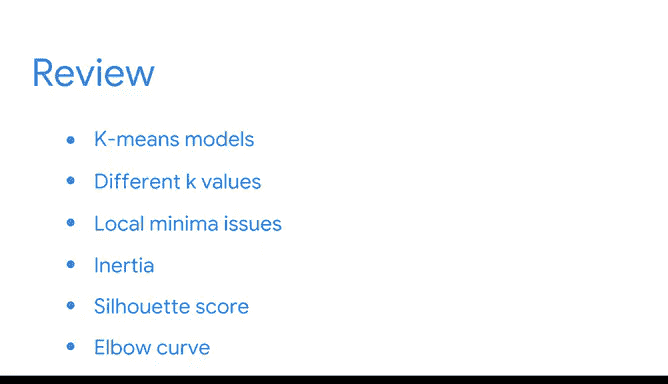
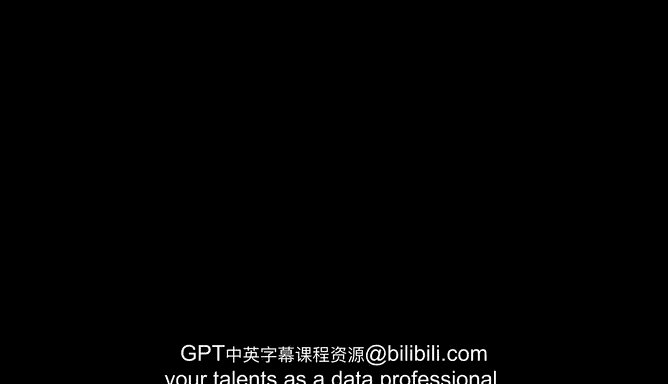

# 谷歌高阶数据分析6：《机器学习的基础知识》the-nuts-and-bolts-of-machine-learning（中英双字） - P35：35_03_01_总结_3.zh_en - GPT中英字幕课程资源 - BV1GW4y1o794

Congratulations， you've reached the end of another section of the course。 along the way。

 you've discovered that unsupervised learning is a vast field with many different applications。

 First， you learned about K means models for deriving structure from your data。😊。

You were introduced to the concept of clustering similar groups of data around centroids and building a K means model。

 we explored the importance of running a K means model multiple times with different values for K。

We also explained the issues with local Minma and how to build models with different centroid initializations to make sure you're getting the most accurate results。

You're now much more familiar with inertia and silhouette score methods for choosing the best number of clusters and evaluating the effectiveness of your model。

 And you can identify the elbow of an inertia curve and use it to help determine an optimal K value。

 There's a whole world of unsupervised learning models and methodologies out there。

 This is just the beginning。 But now you're empowered with key tools for navigating the landscape and developing your talents as a data professional。

😊。

