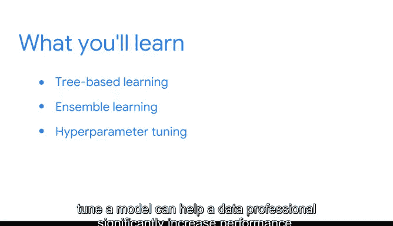

# 谷歌高阶数据分析6：《机器学习的基础知识》the-nuts-and-bolts-of-machine-learning（中英双字） - P36：36_04_01_欢迎来到模块4.zh_en - GPT中英字幕课程资源 - BV1GW4y1o794

Hello and welcome back you've come so far building models of your own using the tools and skills you've been learning throughout this program。

Now， in this final part of the course， you'll revisit supervised machine learning by investigating some more advanced classification techniques。

These advancements are very exciting for data professionals because they enable us to overcome some typical modeling limitations。

One such method is tree based learning。Tree based learning is a type of supervised machine learning that performs classification and regression tasks。

It uses a decision tree as a predictive model to go from observations about an item represented by the branches to conclusions about the item's target value。

 represented by the leaves。Soon， you'll learn how single decision trees provide a foundation for more advanced approaches to all kinds of data work。

 Then you'll move on to ensemble learning techniques which enable you to use multiple decision trees simultaneously in order to produce very powerful models In addition to learning how these new models work and their use cases。

 you'll be introduced to hyperparameter tuning knowing how and when to adjust or tune a model can help a data professional significantly increase performance。

Together， we're going to build models that can be very impactful for tons of different business applications。

 What you're about to learn can really make you stand out to employers in the industry。

 Let's get started。

