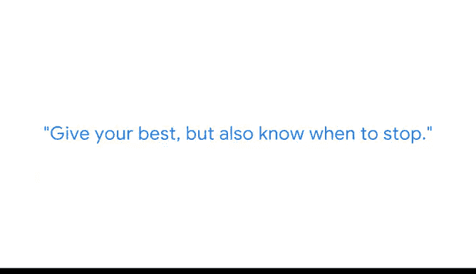

# 谷歌高阶数据分析6：《机器学习的基础知识》the-nuts-and-bolts-of-machine-learning（中英双字） - P37：37_04_02_Daisy-突出技术和人际技能.zh_en - GPT中英字幕课程资源 - BV1GW4y1o794

Hi I'm Daisy， data science manager at Google， I did a team of data scientists we focus on delivery insight a machine learning solution to improve financial analyst their productivityities in the past three years I conduct about 200 interviews I typically hire melel data scientists with some relevant work experience for about at least five years but in the past I also had experienced to hire entry level data scientists as well。

I look for candidates with the experience that they leverage advanced analytics solutions or machine learning solutions to drive business impact。

 having those evidence on the resume or demonstrate those experience throughout the interview is quite critical and I don't really emphasize certain experience from specific industry and the reason is I see a good data scientists can actually leverage their knowledge and then adapt into a different business environment。

 the successful candidates。A those they are able to relate their past projects or their schoolwork to any type of problems。

 our interview questions normally cover two parts， one is focus on understand the candidates their technical knowledge in that aspects we usually will want to understand their coding skill。

 particularly in R or Python and SQL in addition we also want to understand their knowledge in machine learning or statistics as well。

And the second part would be related more on the soft skill in these aspects。

 we care about whether the data scientists can work with the business stakeholders understand their problems and then also be able to recommend the analysis and the insights to kind of help them to solve their business problems。

 sometimes I bump into the candidates that they get stuck on the first questions and then they will keep thinking about that questions throughout the entire interview so that's also something I would definitely encourage the candidates I give your best but also know when to stop。

If you are interested becoming a data scientist but you don't have previous work experience in this field。

 I would recommend you to start thinking about build up your portfolio that can be through doing like capstone projects from the online courses or certificate program and also do some pro bono work as well。

 and then there's also many Kco type of competitions that will help you understand what close to the real worldl problem would look like so definitely highly recommend to build up this portfolio and start to get exposure to the messy data which is close to the real world problem。

