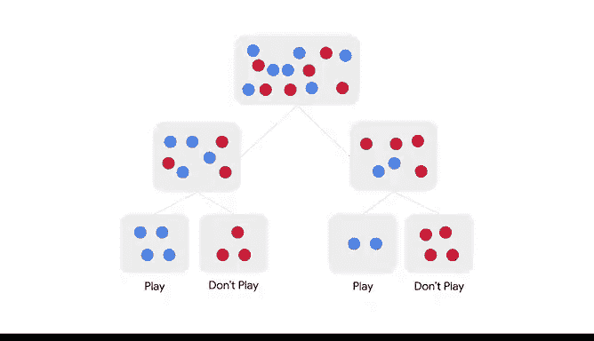

# 谷歌高阶数据分析6：《机器学习的基础知识》the-nuts-and-bolts-of-machine-learning（中英双字） - P38：38_04_03_基于树的建模.zh_en - GPT中英字幕课程资源 - BV1GW4y1o794

In the world of supervised learning， there are tons of techniques that can help you make predictions。

 One popular tool for classification and prediction is the decision tree。

 It serves as a foundation for some of the most effective models used in industry today。

A decision tree is a flow chart， like supervised classification model and a representation of various solutions that are available to solve a given problem based on the possible outcomes of related choices。

Like all supervised learning classification techniques。

 decision trees enable data professionals to make predictions about future events based on the information that is currently available。

 They also have some very specific advantages in certain areas over other supervised learning models。

😊，Decision trees require no assumptions regarding the distribution of underlying data。

 Unlike the models we've covered previously， they can handle cuity easily。 Additionally。

 preparing data to train a decision tree can be a much less complex process。

 requiring little pre processing， if any at all。However， decision trees are not perfect。

 No model is Decion trees can be particularly susceptible to overfitting。

 The model might get extremely good at predicting scene data， but as soon as new data is introduced。

 it may not work nearly as well。 This is something that you'll need to keep in mind while building these types of models。

A decision tree consists of nodes and edges。 The edges connect together the nodes。

 essentially directing from one node to the next along the tree。

Decisions are made at each node at each。 a single feature of the data is considered and decided on。

 By the end， any relevant features will have been resolved。

 resulting in the classification prediction。Let's explore this a little further。

Here's a decision tree that will help you decide whether or not to go outside and play soccer or football on any given day。

The first decision that will be made relates to the weather outlook for this tree。

 There are three options。 sunny， cloudy or rainy。 This node， where the first decision is made。

 is called the root node。 It's the first node in the tree。

 and all decisions needed to make the prediction will stem from it。

 It's a special type of decision node， because it has no predecessors。

 The nodes where a decision is made are decision nodes。

 decision nodes always point to a leaf node or other decision nodes within the tree。

 So for our example， if it's supposed to be sunny or rainy。

 the tree will continue making more decisions to arrive at a final prediction。 However。

 if it's cloudy， the tree arrives at a prediction。 Succer will be played。😊。

This brings us to a leaf node。 Leaf nodes are where a final prediction is made。

 The whole process ends here， so no further decisions are required after this point。Now。

 view where the decision tree would have gone if the outlook had been sunny。

 We're not at a leaf note yet。 There are still decisions to be made。This time。

 the consideration is about the humidity。 If the humidity is above 75 per cent。

 The tree ends at a leaf node that says， don't play soccer。 However。

 if the humidity is below 75 per cent， the decision tree will say play soccer。

 The nodes that are pointed to whether leaf nodes or other decision nodes are child nodes。

 The node that is pointing to them is parent node。 The algorithm decides what and where variables are split based on what will provide the most predictive power。

 So， for example， if 90 per cent of the time that it rains。 Soccer is not played。

 This variable would be very predictive。 Spting the data on outlook would give new groups。

 each of which has a majority of play and don't play。😊。

Now you know the basics of decision trees， this foundation will be helpful as you continue learning about tree based modeling。

Coming up， you'll cover the aspects of building the tree and using your training data to develop the nodes and edges。

 Then you'll learn how to optimize tree based models and what you， as a data professional。

 can do to maximize their capabilities。