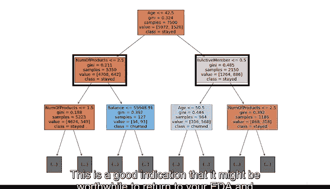

# 谷歌高阶数据分析6：《机器学习的基础知识》the-nuts-and-bolts-of-machine-learning（中英双字） - P39：39_04_05_用Python构建决策树.zh_en - GPT中英字幕课程资源 - BV1GW4y1o794

Now that you've developed a solid understanding of classification models。

 it's time to build a model that's a bit more advanced。In this video。

 you'll examine how to create a single standard decision tree in Python。

We're going to use a decision tree to approach the same business need as with the naive Bayase model from earlier。

 modeling customer bank churn。The first thing， as always。

 is to import any necessary packages and libraries into our notebook。

 You've experienced most of these before， but the packages for the decision tree itself are new。

Let's import decision tree classifier， the side kit learn implementation of a single decision tree。

 additionally， import the plot tree function to produce a visual of the decision tree after it's built。

We also import the confusion matrix and Con matrix display functions to help us calculate and plot a confusion matrix for our model。

And lastly， we have our four evaluation metrics。We're going to read in the original data set as a pannda's data frame as usual remember。

 this is where you'd normally do exploratory data analysis or EDA。

 then you would use what you learned from EDA and what you know about the use case of your model to decide on an appropriate evaluation metric。

For our bank churn models， we're going to assume that a metric that balances precision and recall is best。

 the metric that helps us achieve this balance is F1 score。

 which is defined as the harmonic mean of precision and recall。

 or their product divided by their sum。Again， there are many metrics to choose from the important thing is that you make an informed decision that is based on your use case now that we've decided on an evaluation metric。

 let's prepare the data for modeling。Just as before。

 we'll drop the unpredictive features and the gender column so our model doesn't predict based on gender。

Then will dummy encode the geography column， creating Booleian columns from the categorical column。

Our last preparation is to separate our target variable from the rest of the data and then split the data into training and test sets using the train test split function don't forget to stratify based on the target。

The first thing we'll do is train a baseline decision tree model， we won't tune it。

 it's just to give us scores that we can use as points of reference we do this by instantiating the classifier and setting the random state。

We'll assign it to a variable called Dec tree。Next， we'll fit it to the training data。

 this grows a decision tree on our data， it all happens behind the scenes。Finally。

 we'll use the predict method to use the tree we just grew to make predictions on the X test data。

 assigning the results to a variable called DTP。Now we can get the results by using the different evaluation metric functions we imported。

This model's F1 score is better than what we got from the naive Bayase model we built。

Let's inspect the confusion matrix of our decision trees predictions first we'll write a short helper function to help us display the matrix。

Notice from this confusion matrix that the model correctly predicts many true negatives。

 this is to be expected because the data is imbalanced in favor of negatives。

When the model makes an error， it appears slightly more likely to predict a false positive than a false negative。

 but it's generally balanced。This is reflected in the precision and recall scores both being very close to each other。

Next， let's examine the splits of the tree， we'll do this by using the plot tree function that we imported。

We pass to it our fit model as well as some additional parameters。

Note that if we did not set max depth equals 2， the function would return a plot of the entire tree all the way down to the leaf node。

 but we are most interested in the splits nearest the root。

 because these tell us the most predictive features。

Class names displays what the majority class of each node is。

 and filled colors the nodes according to their majority class how do we read this plot？

The first line of information in each node is the feature and split point that the model identified as being the most predictive。

In other words， this is the question that's being asked at that split。For our root node。

 the question was， is the customer less than or equal to 42 and a half years old？At each node。

 if the answer to the question it asks is yes， the sample would move to the child node on the left；

 if the answer is no， the sample would go to the child node on the right。

Genie refers to the node's genie impurity This is a way of measuring how pure a node is the value can range from 0 to 0。

5 a genie score of 0 means there's no impurity， the node is a leaf and all of its samples are of a single class。

A score of 0。5 means the classes are all equally represented in that node。

Samples is how many samples are in that node and value indicates how many of each class are in the node returning to the root node。

 we have value equals 5972 and 1528 noticeice that these numbers sum to 7，500。

 which is the number of samples in the node This tells us that 5972 customers in this node stayed and 1528 customers churned。

Lastly， we have class， this tells us the majority class of the samples in each node。

If we look at the top of the tree， this plot tells us that if we could only do a single split on a single variable。

 the one that would most help us predict whether a customer will churn is their age。

If we look at the nodes at depth1， we notice that the number of products and whether or not the customer is an active member also are both strong predictors of whether or not they will churn This is a good indication that it might be worthwhile to return to your EDA and examine these features more closely。

Now that you have a basic understanding of how tree based modeling works in Python。

 you have two more techniques to learn before moving on to some more powerful optimization techniques。

 hyperparameter tuning and cross validation using these。

 we can optimize single decision trees even further and you'll use those concepts to supercharge the models you'll learn later on Me you again soon。

